# MayaMetaBridge — 사용자 가이드

[🇺🇸 English](./index.md) | 🇰🇷 한국어

MayaMetaBridge(MMB)는 Epic Games의 **MetaHuman** 캐릭터를 Maya 2027로
가져옵니다. DNA 파일에서 어셈블하고, 얼굴을 움직이고, 몸을 다시 빚고, 옷을
입히고, mGear로 리그를 만들고, Unreal Engine · Cascadeur · Marvelous
Designer · ARKit으로 내보냅니다.

블렌더 애드온 **MetaBridge DNA**의 포팅입니다. 같은 DNA 파일, 같은 RigLogic
얼굴 리그, 같은 규칙을 `maya.cmds`와 OpenMaya로 구현했습니다. 패널과 각 행,
버튼은 그 애드온에서 온 것이므로, 두 가이드의 같은 패널은 같은 패널입니다.

<a href="assets/wide_ko.png">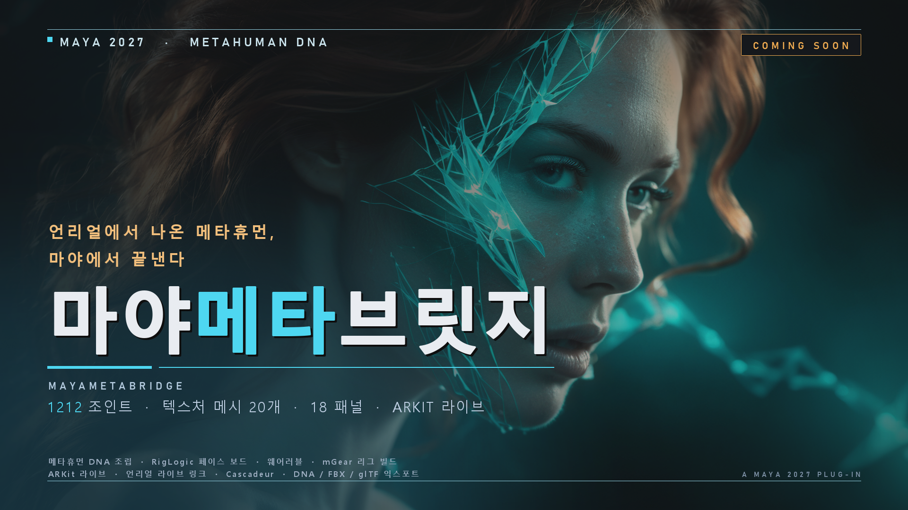</a>

<a href="assets/viewport_face.png">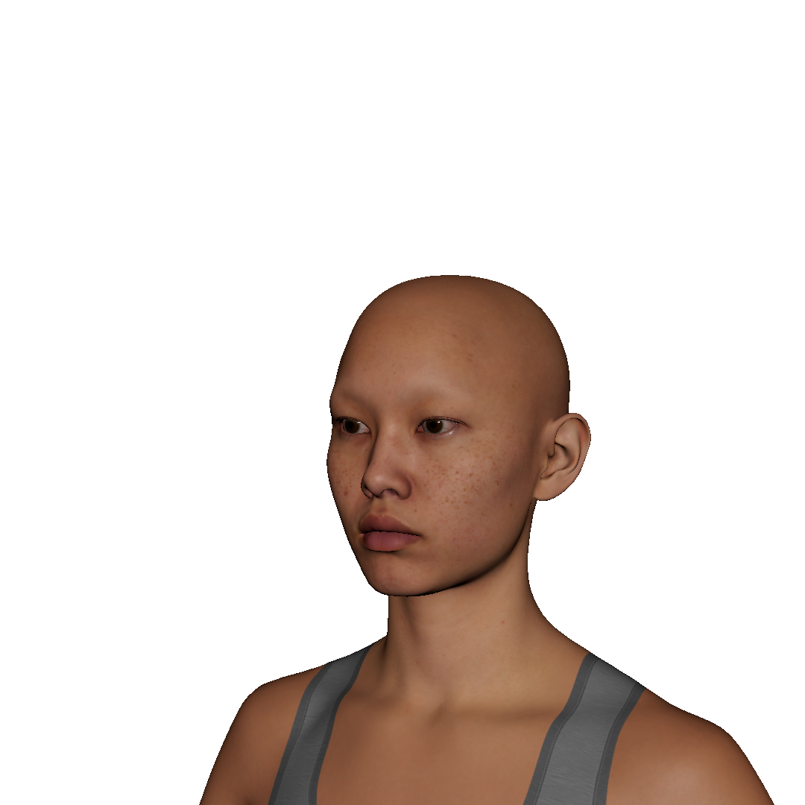</a>

*위 얼굴은 플러그인 자체의 출력입니다. Maya 2027 뷰포트에 `head.dna`와
`body.dna`로 어셈블한 MetaHuman이 자기 `Maps` 폴더의 맵을 입고 있습니다.
대역 렌더가 아닙니다.*

## 이번 버전

**v0.1.0 — 마야 포팅**

- **어셈블** — MetaHuman 폴더를 넣으면 리깅되고 텍스처가 입혀진 캐릭터가
  나옵니다. 이 가이드의 그림이 나온 기준 캐릭터 기준 **관절 1212개**(머리
  870개, 몸 342개)에, 자기 `Maps` 폴더의 맵 **17장**이 20개 재질로
  연결됩니다.
- **얼굴 보드** — Epic의 피커를 플러그인 자체의 `faceboard.json`으로
  만듭니다. 캐릭터가 기대하는 다이얼 그대로입니다.
- **애드온 143개 커맨드 중 124개**를 이식했습니다. 18개 패널 전부, 패널이
  그리는 122개 버튼 전부가 살아 있습니다. 남은 19개는 18개 패널 id와
  오퍼레이터 하나입니다(아래 '포팅의 한계' 절 참고).
- **XGen 그룸으로 불러오는 헤어** — Alembic 그룸이 머리 위의 XGen 인터랙티브
  그룸 디스크립션 *하나*로 들어옵니다(가닥마다 노드가 생기지 않습니다).
  가이드/스트랜드 선택, 끌어서 맞추는 실시간 미리보기, 머리를 따라가게 하는
  바인드가 있습니다.
- **리그에 맞춘 ARKit** — 월드 축 기준 머리 회전, **Calibrate Neutral Face**
  버튼, 그리고 리그가 실제로 하는 동작에 맞춰 고친 눈 깜빡임·혀·볼 부풀리기·
  "우".
- **애드온 방식의 Body Blend** — 썸네일이 있는 소스 목록, 기준(primary) 행,
  머리 블렌딩, 등록된 슬롯으로 만들어지는 캐릭터, 실시간 미리보기. 그리고
  블렌드되는 슬라이더 방식의 **표정 프리셋**.
- **Arnold 룩데브** — 캐릭터를 놓고 볼 이 포트 자체의 씬입니다. 재질마다
  Arnold 쌍둥이 노드를 만들고(**XGen 그룸 헤어까지** — 여태 포트가 셰이더를
  못 입히던 유일한 부위입니다), 스카이 돔을 포함한 5등 뷰티 라이트 릭과
  85mm 바스트·50mm 전신 카메라, 스틸 촬영용 렌더 셋팅을 세팅합니다. 렌더는
  **GPU**로 하고(못 하면 CPU로 폴백), Arnold GPU가 못 하는 두 가지는
  미리 처리합니다. 그룸에는 `aiStandardHair`를 넣고(마야 자체
  `hairPhysicalShader`는 GPU 구현이 아예 없어서 MtoA가 세션을 통째로
  죽였습니다), GPU에서는 어댑티브 샘플링을 **끕니다**(MtoA 5.6.2는 거부하지
  않고 크래시합니다). 이 버튼은 **노출까지 맞춥니다** — 이게 "조명 맞은
  캐릭터"와 "하얗게 타버린 덩어리"의 차이입니다. 얼굴을 작게 한 번
  프로브 렌더한 뒤 RenderView가 보여주는 표시 공간에서 피부 밝기를 읽고,
  릭 전체(사실상 얼굴을 비추는 주광인 스카이 돔 포함)를 움직여 **리트
  볼**을 샘플 사진에서 실측한 값(중간값 0.59 / 75퍼센타일 0.79)에
  앉힙니다. 이때 카메라가 보는 돔(=배경)은 디자인 값에 고정되므로 배경이
  같이 어두워지지 않습니다. 실제 캐릭터로 측정: 디자인 값에서는 얼굴이
  1.00(전부 잘림)이었는데 버튼 한 번에 0.61 / 0.78, 잘린 픽셀 0%, 배경
  0.84가 됩니다(샘플 사진 0.59 / 0.79, 배경 0.90). 세 버튼은 메인 패널의
  **Arnold Look-Dev (Maya-only)** 프레임에 있습니다.
- **mGear 원클릭** — 포팅이 아니라 이 포트의 자체 기능입니다. 블렌더
  애드온은 Rigify로 리깅하고, 마야에는 mGear가 있습니다. 한 번 누르면
  mGear의 MetaHuman 가이드를 캐릭터 관절에 놓고 Shifter 리그를 그 위에
  만들고, 머리를 바인딩해서 얼굴이 몸을 따라가게 합니다.

## 무엇을 하는 플러그인인가

- `.dna` 파일에서 MetaHuman 캐릭터(머리 + 몸)를 마야로 가져옵니다
- 얼굴 보드의 다이얼을 돌리거나, **아이폰**으로 얼굴을 실시간으로 구동합니다
- 표정을 프리셋으로 저장하고, 여러 개를 슬라이더로 동시에 블렌딩합니다
- 비율 슬라이더로 몸을 다시 빚습니다 — DNA가 슬라이더를 따라갑니다
- 여러 바디를 하나로 블렌딩합니다
- 캐릭터에 의상·헤어·액세서리를 입히고, 계속 입고 있게 합니다
- **mGear**로 애니메이션 가능한 몸 리그를 만들고, 애니메이션을 리타겟합니다
- 피부에 커렉티브를 조각하고, 입은 옷까지 동기화합니다
- 전부 **DNA**, **FBX**, **glTF**로 다시 내보냅니다

마야에는 **N 패널**이 없습니다. 애드온은 사이드바 하나에 18개 패널을
그리지만, 여기서는 패널마다 창이 하나이고, 닿는 길이 둘입니다. 마야
메뉴바의 **MMB** 메뉴와, 모든 패널을 나열하고 포팅 진행 상황을 말하는
허브(**Show MMB Window**)입니다.

## 설치

1. 이 폴더를 도구를 두는 곳 아무 데나 풉니다. **폴더는 있는 자리에서
   쓰입니다** — 나중에 옮기지 마세요.
2. 마야의 Python(또는 아무 Python 3)으로 설치 스크립트를 실행합니다:

   ```
   python installer/install.py
   ```

   마야를 여러 개 설치했다면 `--maya-version 2027`, 되돌리려면 `--remove`를
   붙입니다.
3. 마야를 다시 시작합니다. 메뉴바에 **MMB** 메뉴가 생깁니다.

설치 스크립트가 건드리는 것은 마야 환경설정의
`<prefs>/scripts/userSetup.py` 한 블록뿐이고, 그 안에서 `loadPlugin` 하나를
첫 idle로 미룹니다. 원래 파일은 `userSetup.py.bak-mmbb`로 남고, 블록은
덧붙이지 않고 교체하므로 두 번 실행해도 한 번 실행한 것과 같습니다.
`Maya.env`나 modules 폴더, 그 밖의 환경설정은 건드리지 않습니다.

한 세션만 쓰려면 스크립트 에디터에서:

```python
import maya.cmds as cmds
cmds.loadPlugin(r"<이 폴더>/mmb_plugin.py")
```

마야 **2027**(Python 3.13), Windows 64비트가 필요하고, DNA·RigLogic
라이브러리가 `mmb/lib`에 들어 있어 따로 설치할 것은 없습니다.

### 메뉴

<a href="assets/menu.png">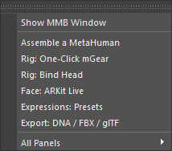</a>

항목 여덟 개, 구분선 둘. 허브, 캐릭터에 실제로 필요한 여섯 가지, 그리고
**All Panels**입니다. `Assemble a MetaHuman`은 곧바로 만들지 않고
**어셈블러 패널을 엽니다** — 만드는 버튼은 패널 안에 있고, 어느 캐릭터를
만들지 고르는 곳도 거기이며, 이미 있는 캐릭터 위에 덮어 만들려는 클릭은
그 자리에서 그렇다고 말할 수 있습니다.

<a href="assets/menu_all_panels.png">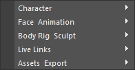</a>

**All Panels** 아래에는 패널마다 항목 하나가 허브의 Pro 보기와 같은 묶음
(**Character**, **Face & Animation**, **Body Rig & Sculpt**, **Live
Links**, **Assets & Export**)으로 들어 있습니다. 각 항목은 그 패널의 창을
열 뿐이고, 메뉴가 버튼을 두 번 그리지는 않습니다.

### 허브, 그리고 두 가지 보기

**Show MMB Window**가 허브를 엽니다. 첫 컨트롤이 보기 전환입니다:

<a href="assets/hub_simple.png">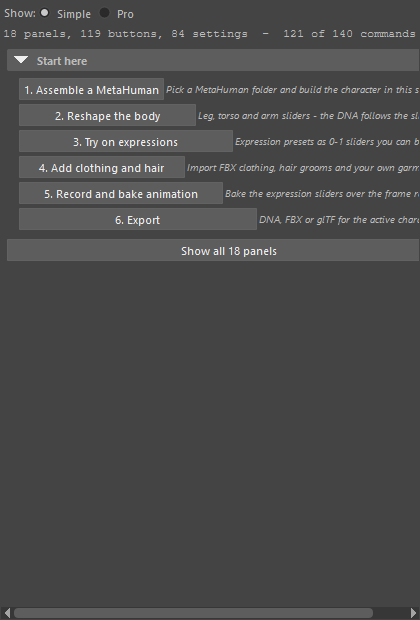</a>
<a href="assets/hub_pro.png">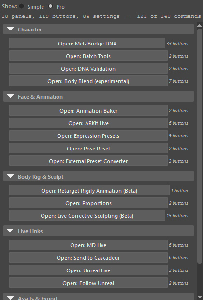</a>

*Simple(왼쪽)은 작업 순서대로 번호를 붙인 여섯 단계입니다 — 어셈블, 몸
다시 빚기, 표정, 옷, 기록, 내보내기. Pro(오른쪽)는 18개 패널 전부를
용도별로 묶고 각 행이 버튼 개수를 말합니다. 전환 아래 줄은 포트의 진행
상황 — `18 panels, 122 buttons, 90 settings — 124 of 143 commands` —
이고, 마지막으로 둔 보기가 기억됩니다.*

<a href="assets/maya_window.png">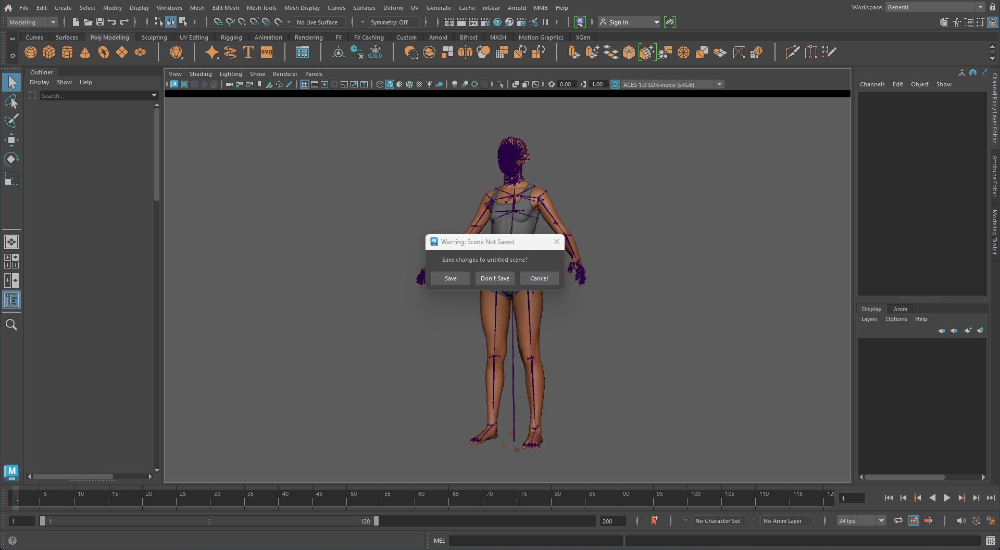</a>

*포트의 창은 평범한 마야 창입니다. 놓은 자리에 도킹되고, 저장한 마야
레이아웃이 다시 불러옵니다(창마다 자기 `uiScript`로 복원합니다).*

<a href="assets/panels_over_character.png">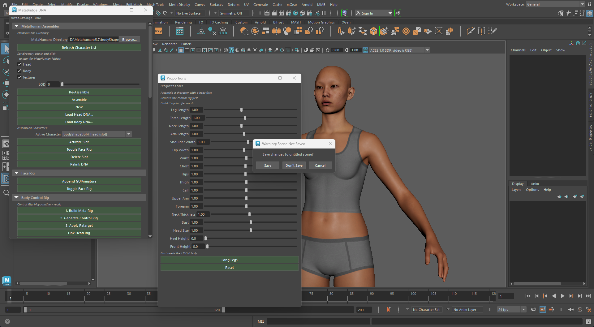</a>

*캐릭터 위에 놓인 둘: 어셈블러와 비율 슬라이더. 세션의 모양이 이렇습니다 —
뷰포트에 캐릭터, 그 옆에 작업 중인 패널.*

### 다른 프로그램용 플러그인

네 기능이 마야 밖의 프로그램으로 나가고, 각각 그쪽에 뭔가가 필요합니다.

| 프로그램 | 무엇이 필요한가 | 쓰이는 곳 |
| --- | --- | --- |
| mGear | 직접 설치한 mGear — `scripts` 폴더를 `MAYA_MODULE_PATH`에 | **One-Click mGear Rig**, Anim Picker (6절) |
| Cascadeur | `third_party/MetaBridgeLive` 폴더 | **Send to Cascadeur** (13절) |
| Unreal Engine | `third_party/MotionForgeLiveLink`, 없으면 첫 사용 때 내려받음 | **Unreal Live**, **Follow Unreal** (14절) |
| Marvelous Designer | `mmb/md_plugin` 폴더 | **MD Live** (12절) |

Cascadeur와 Marvelous Designer 플러그인은 **이 패키지에 들어 있습니다** —
따로 받을 것이 없습니다. Unreal 것은 **Open Unreal Plug-in Folder**를 처음
누를 때 GitHub에서 받으므로 그때만 인터넷이 필요합니다. 처음부터 다 설치할
필요는 없습니다. 아래 각 절에서 필요할 때 자기 것을 설정하고, 쓰지 않는
기능은 비용이 들지 않습니다.

## 1. MetaHuman 어셈블

<a href="assets/panel_main.png">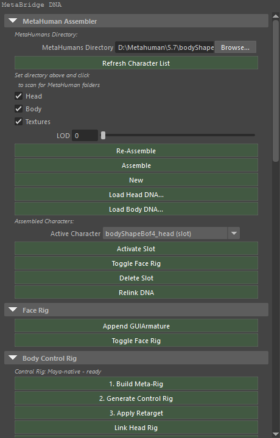</a>

1. **MetaHumans Directory**에서 MetaHuman들이 있는 폴더를 고릅니다. 그
   안에 `head.dna`가 있어야 합니다. 캐릭터 폴더를 가리키면 그 캐릭터의
   형제들도 함께 목록에 오릅니다.
2. **Refresh Character List**를 누르고 캐릭터를 고릅니다.
3. **Head**, **Body**, **Textures**는 켜 둔 채로 둡니다. **LOD**는 어느
   메시 단계를 불러올지 정합니다 — 0이 가장 자세한 단계이고, **Bust**
   슬라이더가 동작하는 유일한 단계입니다(5절).
4. **Assemble**을 누릅니다.

캐릭터는 평범한 마야 노드로 들어옵니다. 스켈레톤, 스킨된 메시(DNA 옆
`Maps` 폴더에 재질이 연결됩니다), 그리고 **얼굴 보드**(2절)입니다. 이
가이드의 그림이 나온 기준 캐릭터에서 측정한 값: **관절 1212개**(머리
870개, 몸 342개), 맵 **17장**이 20개 재질로 연결.

<a href="assets/viewport_full_body.png">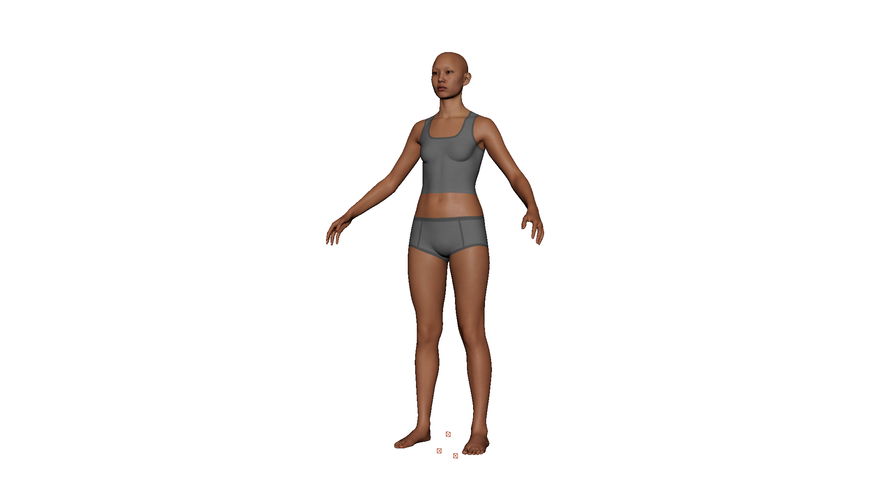</a>

**Assembled Characters**는 씬에 있는 캐릭터 목록입니다. **Activate
Slot**은 하나를 활성으로 만들고(플러그인의 나머지 대부분이 활성 슬롯을
대상으로 합니다), **Toggle Face Rig**는 그 캐릭터의 얼굴 보드를 보이거나
숨기고, **Delete Slot**은 목록에서 빼고, **Relink DNA**는 파일이 옮겨진
슬롯을 다시 그 DNA 파일로 연결합니다. **Load Head DNA…**, **Load Body
DNA…**는 한쪽 파트만 따로 가져옵니다.

패널에서 알아 둘 두 가지: **Re-Assemble**은 **Assemble**과 같은
커맨드입니다(작업 도중 슬롯이 어긋났을 때 누르라고 있는 버튼입니다).
그리고 패널 아래쪽 **mGear Rig** 프레임은 6절입니다.

## 2. 얼굴 보드

MetaHuman을 어셈블하면 리그 말고도 하나가 더 씬에 남습니다. 머리 옆의
**얼굴 보드(피커)** 이고, 표정마다 컨트롤이 하나씩 있습니다. 이것은 포트가
만든 것이 아니라 Epic의 보드입니다 — 마야 플러그인이 쓰는 것과 같은
`faceboard.json`(GUI 컨트롤 175개 + 아날로그 3개, 각각 모양·색·한계·슬라이더
트랙 포함)으로 플러그인이 직접 만듭니다. 여기서 연 턱은 캐릭터의 RigLogic이
기대하는 그 턱입니다.

보드의 다이얼 값이 나머지 모든 기능의 인터페이스입니다.

- **ARKit Live**(4절)가 아이폰으로 이 값을 움직이고,
- **Expression Presets**(3절)가 저장하고 다시 적용하고,
- **Animation Baker**(15절)가 프레임 범위로 굽고,
- **Pose Reset**(15절)이 중립으로 되돌리고,
- **RigLogic 얼굴 리그**가 이 값을 계산해 피부를 움직입니다 — 편집할
  셰이프 키가 없습니다.

**Toggle Face Rig**(메인 패널, Face Rig 프레임)가 보드를 보이고 숨깁니다.
몸이 리그 위에 있으면(5절이나 6절) 머리 파트가 그 리그를 따라갑니다.
머리가 링크되지 않은 캐릭터는 목이 아니라 얼굴만 돌아갑니다.

**RNA 목록**(메인 패널의 *RNA* 탭)은 DNA의 raw 컨트롤 채널을 그것을 구동하는
컨트롤과 함께 보여 줍니다. **View**로 DNA 보기(채널 한 줄: `rc#`, 채널, 연결된
컨트롤, *Connect* / *Change* / *x*)와 Bone 보기(컨트롤 한 줄에 채널들)를
바꿉니다. **Filter**, **Show**(All / Mapped / Unmapped), **Parent**,
**Per Page**를 바꾸면 목록이 바로 다시 그려지고, 페이지는 **< Prev / Next >**
입니다. *Connect*는 컨트롤을 물어 캐릭터와 함께 매핑을 저장하고, **Clear
All**은 수동 매핑을 모두 지워 채널을 원래 컨트롤로 돌려놓습니다. 몸 전용
DNA에는 얼굴 채널이 없고, 목록이 그렇게 말해 줍니다.

## 3. 표정 프리셋

<a href="assets/panel_pose_presets.png">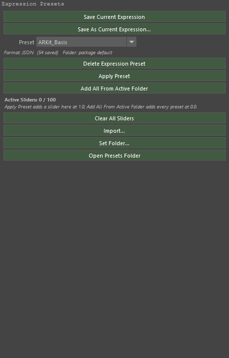</a>

프리셋은 얼굴 보드 다이얼 값을 컨트롤 이름으로 키를 잡아 저장한 JSON
파일입니다. 그래서 씬과 머신 사이를 옮겨 다닙니다.

- **Save Current Expression**은 지금 값으로 목록에서 고른 프리셋을
  덮어쓰고, **Save As Current Expression…**은 새로 만듭니다.
- **Apply Preset**은 얼굴을 그 포즈로 맞추지 **않습니다**. 프리셋을
  슬라이더 목록에 `1.0`으로 추가하고, 얼굴은 그 목록 전체의 블렌딩이
  됩니다. 같은 턱을 여는 두 프리셋이 더해져 더 커지지는 않습니다 — 블렌드는
  컨트롤마다 큰 쪽 기여를 취합니다.
- **Add All From Active Folder**는 폴더의 모든 프리셋을 `0.0`으로
  추가합니다. 폴더 하나가 서서히 켜는 슬라이더 뱅크가 됩니다.
- **Clear All Sliders**는 목록을 비우고 얼굴을 중립으로 되돌립니다.
  **Delete Expression Preset**은 파일을 지우고, **Set Folder…**와 **Open
  Presets Folder**는 프리셋이 사는 폴더를 다룹니다.

**ARKit 프리셋은 플러그인에 들어 있습니다**: `mmb/presets/ARKit`에
블렌드셰이프마다 `ARKit_<이름>.json` 하나, 그 옆에 이름 매핑이 있습니다.
그 매핑을 ARKit Live(4절)가 사용합니다.

## 4. ARKit Live — 아이폰의 얼굴

<a href="assets/panel_arkit_live.png">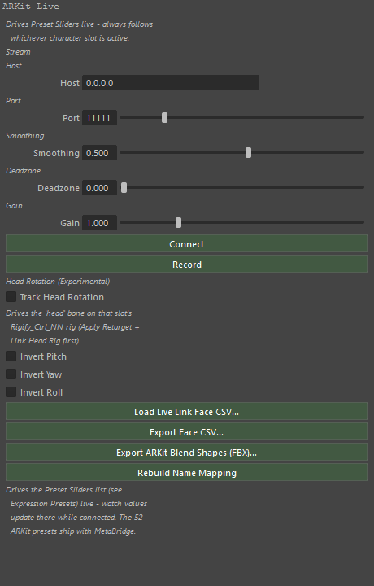</a>

애플의 **Live Link Face** 앱은 52개 ARKit 블렌드셰이프를 UDP로
빅엔디언 float으로 보냅니다. 플러그인은 백그라운드 소켓으로 받아 두고,
씬은 idle 잡에서 — 마야의 메인 스레드에서 — 건드립니다.

1. Live Link Face에서 스트림을 이 머신으로 보냅니다(앱의 기본 포트가
   **11111**이고, 패널도 그 포트입니다).
2. **Host**가 `0.0.0.0`이면 모든 인터페이스로 받습니다. 하나로 묶으려면
   바꿉니다.
3. **Connect**. 말을 하면 얼굴이 따라옵니다.
4. **Smoothing**(`0.5`), **Deadzone**(`0`), **Gain**(`1.0`)으로
   다듬습니다. 애드온과 같은 방식으로 블렌드셰이프마다 적용됩니다.

**Record**는 적용된 값을 키로 기록하고, **Load Live Link Face CSV…**는
앱이 직접 녹화한 CSV를 대신 받습니다(프레임마다 한 행). **Export Face
CSV…**는 지금 얼굴을 같은 형식으로 씁니다. **Export ARKit Blend Shapes
(FBX)…**는 ARKit 이름의 블렌드셰이프 세트를 FBX로 내보내고, **Rebuild
Name Mapping**은 이름 규칙이 맞지 않는 캐릭터가 왔을 때 ARKit 이름과 보드
컨트롤 사이 매핑을 다시 만듭니다.

**Head Rotation (Experimental)** 은 폰의 머리 자세로 캐릭터의 머리를
돌립니다. 피치는 월드 X축(끄덕임), 요는 Y축(좌우 회전), 롤은 Z축(기울임)
기준이며, 머리가 원래 가진 방향 위에 얹습니다. 폰을 든 방향 때문에 한
방향이 반대로 나오면 **Invert Pitch / Yaw / Roll**을 쓰세요.

**Calibrate Neutral Face** — 폰은 편안한 얼굴도 0으로 보내지 않습니다.
mouthShrug, mouthRoll, mouthStretch 같은 모양이 각각 0.1~0.3에 있어서
합치면 입이 조금 벌어지고, 편안한 눈은 `eyeWide` 0.4로 읽힙니다. 편하게,
입은 다물고, 눈은 평소처럼 뜬 채로 누르세요. 1초 동안의 평균이 기준 얼굴이
되고 모든 모양을 그 기준에서 잽니다. 눈이 조금 작아져 `eyeWide`가 *줄면*
버려지지 않고 눈꺼풀이 조금 내려갑니다. **Clear Neutral Calibration**은
기준을 지웁니다. 기준은 설정과 함께 저장됩니다.

이 리그에 맞춰 네 가지를 고쳤습니다. 애드온의 프리셋과 보드의 DNA가 일부
컨트롤의 방향을 반대로 잡고 있기 때문입니다(36개 채널, 눈 깜빡임과 혀
in/out 포함). **눈 깜빡임**은 눈꺼풀을 닫고 *eyeWide*는 엽니다.
**tongueOut**은 혀를 내밀고, **cheekPuff**는 입술을 다문 채 볼을
부풀립니다(프리셋은 입술도 앞으로 불었습니다). **mouthPucker**는 입꼬리
컨트롤로 입을 좁혀 "우"가 "우"로 읽히게 합니다.

## 5. 비율(Proportions)

<a href="assets/panel_proportions.png">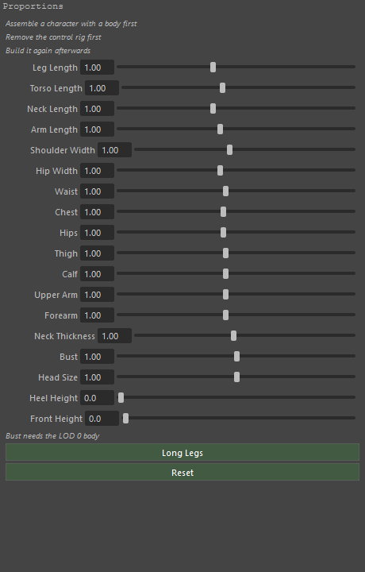</a>

슬라이더 18개, 모두 캐릭터를 만든 그 상태에 대한 배수이고 `1.0`이 그
캐릭터입니다. **슬라이더를 움직이면 캐릭터가 움직입니다** — 애드온과
마찬가지로 Apply 버튼이 없습니다.

| 묶음 | 슬라이더 | 범위 |
| --- | --- | --- |
| 길이 | Leg Length | 0.80 – 1.30 |
| 길이 | Torso Length | 0.85 – 1.20 |
| 길이 | Neck Length | 0.80 – 1.30 |
| 길이 | Arm Length | 0.85 – 1.20 |
| 너비 | Shoulder Width | 0.85 – 1.20 |
| 너비 | Hip Width | 0.85 – 1.20 |
| 너비 | Waist | 0.75 – 1.30 |
| 너비 | Chest | 0.80 – 1.25 |
| 너비 | Hips | 0.80 – 1.25 |
| 너비 | Thigh | 0.75 – 1.30 |
| 너비 | Calf | 0.75 – 1.30 |
| 너비 | Upper Arm | 0.75 – 1.30 |
| 너비 | Forearm | 0.75 – 1.30 |
| 너비 | Neck Thickness | 0.80 – 1.25 |
| 형태 | Bust | 0.50 – 1.50 — **LOD 0** 몸이 필요합니다 |
| 크기 | Head Size | 0.90 – 1.10 |
| 신발 | Heel Height | 0 – 15 cm |
| 신발 | Front Height | 0 – 5 cm |

슬라이더가 하는 일과 일부러 하지 않는 일:

- 길이는 구간을 **늘립니다**. 본을 스케일하는 대신 그 끝의 관절을
  옮기므로, 넓적다리가 길어져도 두꺼워지지 않습니다.
- 너비는 그 너비를 재는 관절을 옮기고, 엉덩이는 좌우 오프셋만 스케일합니다.
- 몸 전체가 발과 함께 움직입니다. 다리가 길어지면 발바닥이 바닥을 뚫는
  대신 캐릭터가 올라갑니다.
- 피부는 자기 **스키닝**으로 따라갑니다. 마야 캐릭터는 관절이 움직이면
  그렇게 하고, 메시 필드(둘레·가슴·신발·머리)가 같은 본 이동 위에
  더해집니다.
- 모든 변화는 **다시** 레스트 스켈레톤에서 계산합니다. 그래서 누적되지
  않고, 슬라이더를 `1.0`으로 되돌리면 정확히 원래 캐릭터가 돌아옵니다.

**Long Legs**가 애드온의 원클릭 룩을, **Reset**이 모든 슬라이더를
되돌립니다.

패널이 말하는 두 가지는 사실입니다. **몸이 있는** 캐릭터를 먼저
어셈블하고, 컨트롤 리그(6절)가 캐릭터 위에 서 있다면 빼고 나서 다시
빚고, 그 뒤에 다시 만드세요.

## 6. 몸 리그 — mGear 원클릭

<a href="assets/viewport_rig.png">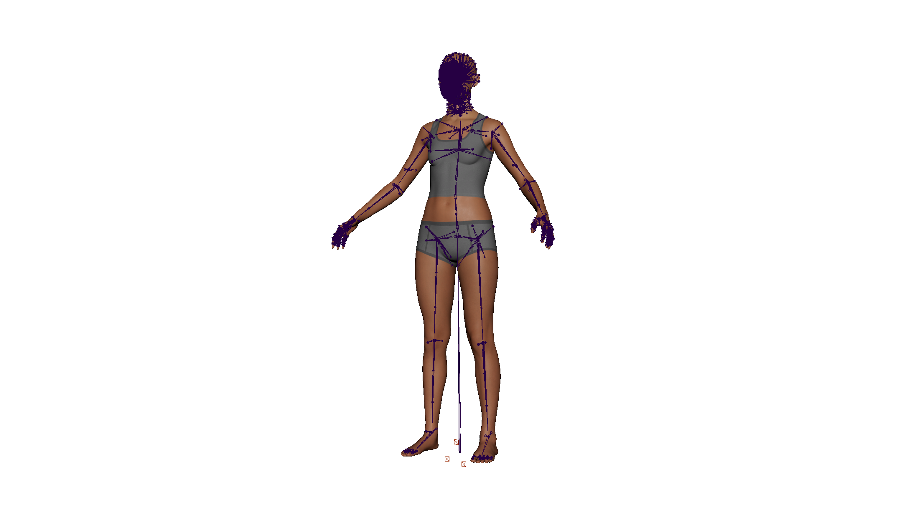</a>

*캐릭터 자체의 스켈레톤 — 관절 1212개 — 이고, 몸 리그는 이 위에 만들어집니다.*

<a href="assets/viewport_mgear_rig.png">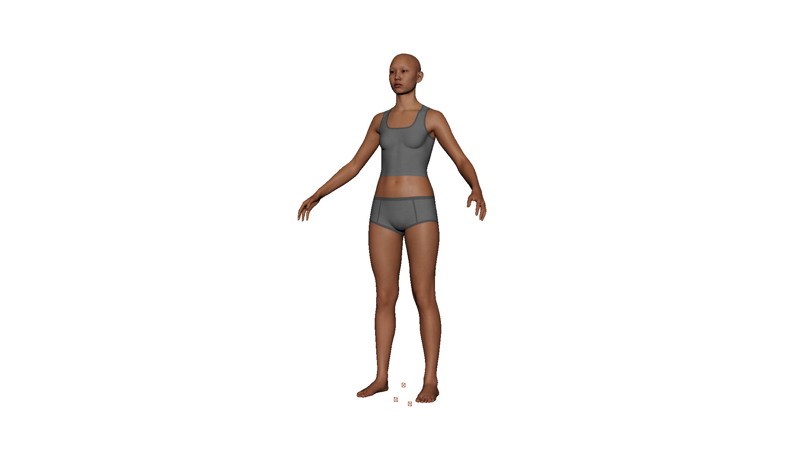</a>

*원클릭이 만든 리그 위의 같은 캐릭터.*

이것은 포트 자체의 기능입니다. 블렌더 애드온은 **Rigify**로 리깅합니다.
마야에는 **mGear**가 있고 MetaHuman 사용자는 이미 설치해 두었으므로, 한
번 누르면 mGear 자체의 MetaHuman 가이드를 캐릭터 관절에 놓고 그 위에
mGear의 **Shifter** 리그를 만듭니다.

먼저 mGear의 `scripts` 폴더를 `MAYA_MODULE_PATH`에 두세요. 그다음 메인
패널의 **mGear Rig (Maya-only)** 프레임에서:

| 버튼 | 하는 일 |
| --- | --- |
| One-Click mGear Rig | 가이드를 캐릭터에 스냅하고, 리그를 만들고, 머리를 바인딩 |
| Snap mGear Guide | 손으로 옮긴 가이드의 로케이터를 다시 관절 위로 |
| Bind Head to mGear Rig | 머리 파트를 mGear가 움직이는 몸 관절에 구속(원클릭이 이미 합니다) |
| Unbind Head from mGear Rig | 그 구속을 다시 뺌. 머리는 있던 값 그대로 |
| Register Anim Picker | 이 리그용 mGear Anim Picker(몸·얼굴 페이지)를 만들고 엶 |
| Remove mGear Rig | 가이드와 리그를 지움. 캐릭터는 그대로 |

플러그인이 숨기지 않고 말하는 두 가지가 있습니다. 캐릭터에 없는 관절을
가진 가이드 로케이터는 **템플릿이 놓은 자리에 그대로 남고**(콘솔이 어느
것인지 말합니다), MetaHuman은 **관절 이름을 공유하는 두 스켈레톤**(목
등)이므로 mGear가 연결하는 동안 다른 파트의 관절에 임시 이름을 주고,
끝난 뒤 원래 이름으로 되돌립니다.

### 애드온 자체의 리그 버튼

메인 패널의 **Rigify Body Control Rig** 프레임은 애드온의 리그
워크플로이고, 마야에서는 캐릭터의 주요 관절 위에 **마야 컨트롤 리그**를
만듭니다(애드온의 두 단계 `1. Build Meta-Rig`, `2. Generate Control Rig`,
그리고 캐릭터가 리그를 따라가게 하는 `3. Apply Retarget`). 그 옆에:

- **Remove Retarget** / **Remove Control Rig** — 다시 빼기
- **Link Head Rig** / **Unlink Head Rig** — 머리 파트 연결. 얼굴이 몸을
  따라가는 것이 이것입니다
- **Toggle RBF Correctives (Body)**, **Driver Bone**, **Show RBF
  Controls** / **Hide** — 애드온의 RBF 커렉티브 패스와 수동 컨트롤
- **Import FBX Animation…** — 리그에 애니메이션 가져오기
- **Toggle IK Stretch**, **Toggle Heel Pivot**, **Toggle Finger IK**,
  **IK to FK** / **FK to IK**, **Snap Fingertip Targets** — 팔다리와
  손가락 스위치. 손가락별 `0 = 관절, 1 = 손끝` 블렌드 포함

다른 리그의 애니메이션을 *가져오는* 리타겟은 별도 패널입니다 — 15절.

## 7. Body Blend

<a href="assets/panel_body_blend.png">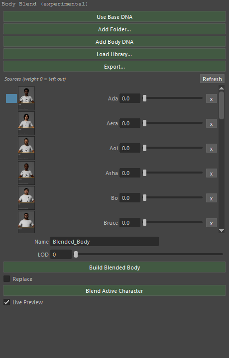</a>

여러 바디를 평균해 새 캐릭터 하나를 만듭니다.

**소스 행**은 바디 DNA 파일(딸린 head DNA 포함)이거나 라이브러리 파일의
아키타입 하나이고, 각각 가중치를 가집니다. 한 행이 **primary**이며
강조됩니다. primary는 실제 DNA 파일이어야 합니다 — 라이브러리 항목은
자기 RigLogic 데이터를 갖고 있지 않고, 새 캐릭터의 리그는 primary에서
만들어지기 때문입니다.

- **Use Base DNA**는 함께 들어 있는 기준 `Body.dna`(와 `Head.dna`)를
  primary 행으로 추가합니다. **Add Body DNA** / **Add Folder…**는 파일을
  가중치 `0`으로 추가하고, **Load Library…**는 라이브러리의 아키타입을
  `0`으로 추가합니다. **Export…**는 라이브러리 파일을 씁니다.
- **Build Blended Body**는 가중치가 있는 행들을 평균합니다 — 몸과, 모든
  행에 head 데이터가 있을 때는 머리도 — 그리고 슬롯 목록에 **새
  캐릭터**를 만듭니다. 이미 있는 캐릭터에 적용하려면 **Blend Active
  Character**를 쓰고, **Replace**가 추가와 교체 중 무엇인지 정합니다.
- **Live Preview**는 기본적으로 꺼져 있습니다. 켜면 가중치를 끄는 동안
  결과가 바로 보입니다.

## 8. Wearables — 의상과 헤어

<a href="assets/panel_wearables.png">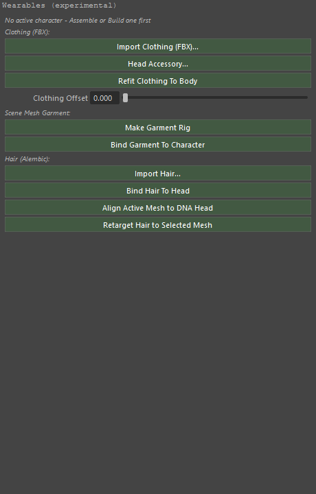</a>

- **Import Clothing (FBX)…** 로 의상을 가져옵니다(머리에 쓰는 것은
  **Head Accessory…**).
- **Make Garment Rig** 다음 **Bind Garment To Character** — 바인딩은
  몸의 스킨 웨이트를 그 조각에 복사합니다. 그래서 그 아래 피부가 움직이는
  방식대로 움직입니다.
- **피부에 맞춰 밀어내기(핏)**는 옷이 캐릭터의 몸 속으로 파고들지 않게 합니다.
  다른 체형 위에서 만든 옷은 이 몸과 다른 곳마다 피부 속으로 들어갑니다.
  핏은 버텍스마다 몸과 머리 피부의 가장 가까운 점을 찾아서, 피부 안쪽에 있거나
  오프셋보다 가까운 버텍스를 피부의 법선 방향으로 밀어냅니다. 그 밖의 것은
  움직이지 않아서 헐렁한 옷은 헐렁한 채로 남고, 피부와 나란히 스치기만 하는
  점도 건드리지 않습니다.
  - **Fit Clothing to Skin**(*Fit to Skin* 프레임)은 선택한 옷을, 선택이
    없으면 입고 있는 모든 것을 핏합니다. **Bind Garment To Character**와
    **Refit**에서도 자동으로 실행됩니다.
  - **Clothing Offset**(0–0.02, 애드온의 미터 단위: 0.01 = 1cm)은 옷과 피부
    사이에 남기는 간격입니다. 최소값은 0.2cm이고, 슬라이더를 움직이면 입고
    있는 옷을 바로 다시 핏합니다. 핏은 언제나 옷을 처음 본 모양에서
    시작하므로 오프셋을 줄이면 옷이 다시 나옵니다. 피부 안쪽 8cm보다 깊은
    점은 다른 표면(몸통 뒤의 팔 같은)으로 보고 끌어오지 않습니다.
  - 스킨이 걸린 옷은 스킨 클러스터가 읽는 원본(rest) 셰이프에 쓰므로
    캐릭터가 움직여도 핏이 유지됩니다.
- **Refit Clothing To Body**는 비율의 둘레 필드를 입고 있는 모든 것에
  다시 적용합니다. 허리가 바뀌면 그 위 옷도 바뀌고, 그 결과를 Clothing
  Offset으로 피부에 핏합니다.
- 헤어는 다른 길이고, **XGen 인터랙티브 그룸**입니다.
  - **Import Hair…**(Alembic)는 파일을 데이터로 읽어 캐릭터 머리 메시 위에
    XGen 스플라인 디스크립션 *하나*를 만듭니다. 가닥마다 노드를 만들지
    않습니다(MetaHuman 그룸은 수십만 가닥이라, 보통 방식으로 불러오면
    Maya가 죽었습니다). 그룸의 Z-up은 Maya의 Y-up으로 돌려집니다.
  - **Import**에서 *Guides + Strands*, *Strands only*, *Guides only*를
    고릅니다. 그룸 익스포터가 쓴 파일은 곡선마다 가이드 표시
    (`groom_guide`)가 있어서 세 가지가 실제로 다릅니다. 표시가 없는 파일은
    전부 스트랜드입니다.
  - **Hair Strands (0 = all)** 은 만들 가닥 수의 상한입니다. XGen은 가닥당
    약 1.4ms로 계산하므로 기본 10,000은 몇 초이고, 완성 단계에서 올리세요.
  - **눈으로 맞추기.** XGen은 그룸 노드 자체를 항등으로 붙잡고 있어서 노드를
    움직여도 아무 일도 없습니다. 임포트하면 로케이터 `MMB_Hair_…_move`와
    그 아래 250가닥의 가벼운 **미리보기**가 생깁니다. 로케이터를 끌면
    미리보기가 즉시 따라오고, 놓아도 파일은 쓰지 않습니다 — 배치는 그룸을
    제자리에 앉히는 버튼(**Bind**, **Retarget**, **Apply Hair Offset / Scale**)이
    한 번 적용합니다. 그래서 헤어 맞추기가 기다림이 아니라 드래그로 남습니다. 헤어를
    선택하면 로케이터가 대신 선택됩니다. **Align Active Mesh to DNA Head**는
    그룸의 뿌리를 **머리 표면 위에** 앉힙니다 — 각 뿌리에서 캐릭터 메시의 가장
    가까운 점까지의 평균 벡터를 반복해 구하고, 세 축 모두 움직이며, 결과에
    측정값(표면까지의 평균·최대 거리, 전후)이 들어 있습니다. 예전에는 바운딩
    박스 규칙이었습니다 — 그룸의 *컨트롤*을 캐릭터 메시 박스의 X/Z 중앙에
    맞추고 높이는 그대로 두는 방식인데, 번들 바디 위에서 샘플 가이드 그룸으로
    실측한 결과 뿌리를 머리에서 **더 멀리** 밀어냈습니다: 버튼 누르기 전
    표면까지 13.23단위, 누른 뒤 17.34단위.    표면 핏은 같은 그룸을
    ``(12, 15, -9)`` 만큼 밀어 놓아도 20.14에서 2.52로 되돌리고, 이미 제자리에
    앉은 그룸은 건드리지 않습니다 — 더 나아지는 스텝만 받기 때문입니다.
    **Hair Offset X/Y/Z**, **Hair Scale**,
    **Apply Hair Offset / Scale**은 숫자로 놓습니다. 숫자는 **절대값**입니다
    — 버튼은 로케이터를 그룸의 원래 중심 + 오프셋에 두고 **Hair Scale**로
    균일 스케일한 뒤, 그 자리에서 파일을 한 번 씁니다. 그래서 손으로 끌어 둔
    위치에 *더해지지 않습니다*: 눈으로 맞춘 뒤 누르면 중심 + 오프셋으로
    돌아갑니다. 대신 같은 숫자는 어느 씬에서든 같은 자리를 주므로 재현이
    됩니다.
  - **Bind Hair To Head**는 그룸을 머리 메시에 다시 앉혀서 스킨과 Body
    Blend를 따라가게 합니다(헤어 *메시*나 커브는 머리 관절에 constraint로
    붙습니다). 임포트가 만든 가벼운 가닥 표시는 **그대로 남습니다.** 그게
    화면에 보이는 헤어이고, 다른 것들과 함께 머리 관절로 옮겨져서 스킨을
    따라갑니다. (예전에는 여기서 이걸 지워서 바인드하면 커브가 사라지는 것처럼
    보였습니다.) **Retarget Hair to Selected Mesh**는 다른 메시에 같은 일을
    합니다. 헤어를 먼저, 메시를 마지막에 선택하세요.
  - 스컬프트 브러시(Comb, Grab, Length, Smooth…)는 그룸에서 동작합니다.
    **Density와 Place는 다른 문제입니다.** 가닥을 *생성하는* 방식을 칠하는
    도구인데 임포트한 그룸은 파일의 가닥 그대로입니다. 실측: 밀도 마스크도,
    배율도, 보간도 2745개 스플라인을 전혀 움직이지 못했고, 같은 프레임을 두
    번 렌더하면 864000바이트 중 0바이트가 달랐습니다.
  - **XGen으로의 그루밍 변환은 없고, 패널도 더 이상 그것을 제공하지 않습니다.**
    Maya 2027은 Alembic 그룸을 XGen 자신의 스플라인/가이드 데이터로 바꾸지
    못합니다. ABC를 받는 유일한 경로는 파일을 그때그때 읽는 스플라인 *수정자*
    (``xgmCurveToSpline``)라서, 디스크립션은 자기 스플라인을 갖지 않고 ABC가
    씬과 함께 다녀야 합니다. 이 머신에서 측정: 리더가 파일 핸들을 잡고 있고,
    Epic의 그룸 익스포터는 스플라인 디스크립션을 거부합니다
    (``Must select either palette or description``) — 클래식 디스크립션만 받고,
    그 경로는 배치 테스트에서 이 Maya를 크래시시켰습니다. 그래서 커브로 또
    하나의 클래식 디스크립션을 자라게 하던 버튼들(**Create XGen Groom**,
    **Apply Hair Length**, **Apply Hair Width**, **Write Groom Collection**,
    **Bake Hair for Render**)을 패널에서 걷어냈습니다. 그것들은 임포트한 헤어를
    변환한 것이 아니라 *다른* 헤어를 만들었습니다. 대신 포트가 하는 일은 XGen이
    실제로 지원하는 것 — 임포트, 배치, 바인드, 그리고 인터랙티브 브러시로
    그루밍(편집은 파일 스플라인 위의 sculpt 레이어로 남습니다).
  - **먼저 놓고, 한 번 바인드합니다.** ``MMB_Hair_…_move``를 끄는 것은 대역
    커브만 움직입니다. 그룸의 Alembic은 "여기가 제자리"라고 말하는 버튼 —
    **Bind Hair To Head**, **Retarget Hair to Selected Mesh**,
    **Apply Hair Offset / Scale**, **Align Active Mesh to DNA Head** — 이 놓을
    때 한 번 씁니다. 드래그를 놓을 때마다 파일을 다시 쓰던 것이 대역 커브를
    만들게 만든 몇 초짜리 멈춤이었습니다.
  - **캐릭터를 지우면 헤어도 함께 지워집니다.** 임포트한 그룸은 씬 루트에
    혼자 서고(로케이터도 그 옆에), 대역 커브는 그 아래에 있습니다. 예전에는
    캐릭터만 지우면 그룸·로케이터·250가닥 대역 커브가 빈자리에 그대로
    남았습니다. 이제 캐릭터의 기록이 헤어를 함께 들고 있어서 셋 다 따라
    지워집니다.

## 9. Live Corrective Sculpting (Beta)

<a href="assets/panel_sculpt_correctives.png">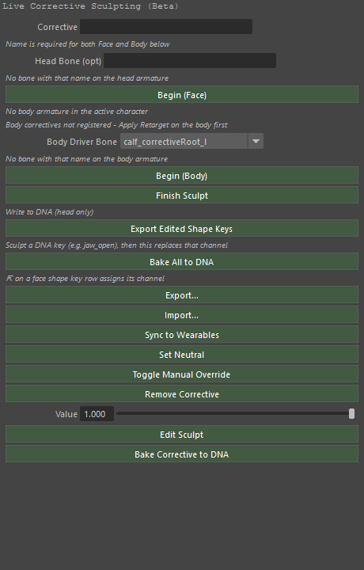</a>

애드온의 워크플로를 옮긴 것입니다. 포즈를 잡은 채 피부를 조각하고, 그
차이를 이름 붙은 커렉티브로 남겨서 그 포즈에서 다시 불러옵니다.

1. 커렉티브 이름(**Corrective**)과, 얼굴이면 **Head Bone**, 몸이면
   **Body Driver Bone**을 정합니다.
2. **Begin (Face)** 또는 **Begin (Body)** 가 기준을 잡습니다 — 지금의
   메시와 그와 함께 있는 포즈입니다. 버텍스를 조각하세요. 차이는 그
   기준에 대해 계산됩니다.
3. **Finish Sculpt**가 그 차이를 스파스하게, 이름을 붙여 캐릭터에
   저장합니다. **Edit Sculpt**는 저장된 커렉티브를 다시 불러 한 번 더
   손보게 하고, **Set Neutral**은 그 커렉티브가 매달린 포즈를 다시
   키잉하고, **Toggle Manual Override**는 항상 켜짐으로 표시하고,
   **Remove Corrective**는 지웁니다.
4. **Sync to Wearables**가 적용된 차이를, 의상 바인딩이 쓰는 것과 같은
   최근접 버텍스 맵으로 입고 있는 옷까지 옮깁니다.
5. **Bake Corrective to DNA**가 그것을 DNA 파일에 씁니다. **Write to DNA
   (head only)**(**Export Edited Shape Keys**)와 **Bake All to DNA**가
   일괄로 같은 일을 합니다. 직접 조각한 DNA 키(예: `jaw_open`)는 **Export
   Edited Shape Keys**를 누르면 그 채널을 대체합니다. **Export…**와
   **Import…**는 레지스트리 전체를 JSON으로 옮깁니다.

델타가 데이터이고, 패널의 나머지는 그 주변의 기록입니다.

## 10. 내보내기

<a href="assets/panel_exporter.png">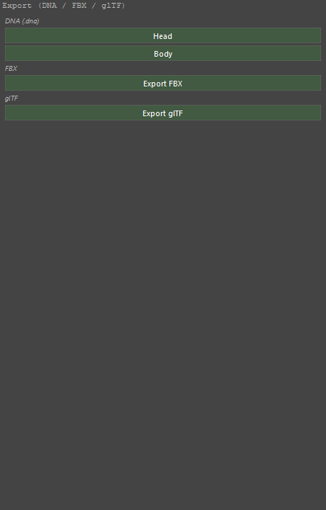</a>

- **Head**와 **Body**는 활성 슬롯의 DNA를 라이브러리 자체의 라이터로
  쓰고, 다시 읽어 확인합니다.
- **Export FBX**는 FBX 플러그인으로, **Export glTF**는 마야의 glTF
  변환기로 캐릭터를 씁니다. 경로를 주지 않으면 파일 대화상자가 뜹니다.

Save Head / Save Body DNA는 같은 두 파일에 제안 이름
(`<원본이름>_export.dna`, 읽어 온 DNA 옆)을 붙이고 **Include Mesh
Edits** 질문에 답합니다. 비율(5절)과 스컬프(9절)가 한 일은 마야
스켈레톤과 메시 위에 있으므로, 라이터가 그 편집을 캐릭터가 온 파일에
패치해 넣습니다 — 그래서 DNA가 화면 위의 캐릭터입니다. 하위 LOD는 가장
가까운 LOD 0 버텍스를 따라갑니다. 그러지 않으면 편집되지 않은 모양으로
남아 멀리서 튀어 보입니다. 메시 편집을 쓸 수 없으면 조용히 넘어가지
않고 크게 말합니다.

**Export All Slots**(11절)는 목록의 모든 슬롯에 대해 DNA 내보내기를
합니다.

## 11. DNA 검증과 일괄 도구

<a href="assets/panel_validation.png">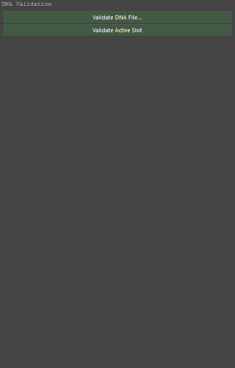</a>
<a href="assets/panel_batch_tools.png">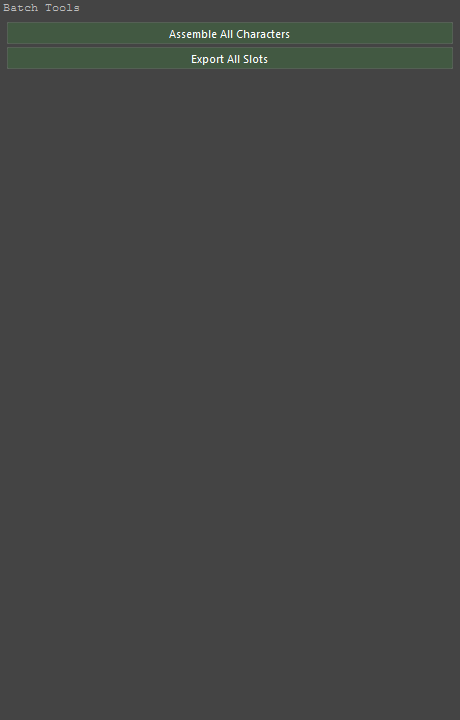</a>

**Validate DNA File…**은 `.dna`를 읽고 무엇이 잘못됐는지 알려주며,
**Validate Active Slot**은 지금 작업 중인 캐릭터에 대해 같은 일을 합니다.
어셈블되지 않을 파일이 파이프라인 뒤쪽에서 트레이스백이 되는 대신, 여기서
문장 하나로 끝납니다.

**Batch Tools**는 버튼 둘입니다. **Assemble All Characters**(플러그인이
가리키는 폴더의 모든 캐릭터)와 **Export All Slots**(씬의 모든 슬롯
DNA)입니다.

## 12. MD Live — Marvelous Designer

<a href="assets/panel_md_live.png">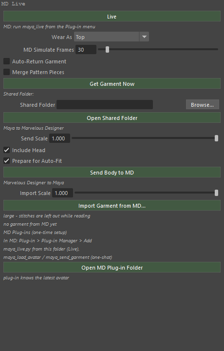</a>

**공유 폴더 하나**에 평범한 파일로 주고받고, `mmb/md_plugin`에 들어 있는
플러그인을 씁니다.

마야 → MD: **Send Body to MD**가 공유 폴더에 아바타 `.obj`를 씁니다
(**Send Scale**, **Include Head**, **Prepare for Auto-Fit**이 무엇이
들어갈지 정합니다). Marvelous Designer에서 플러그인 폴더의 스크립트를
*Plug-in > Plug-in Manager*에 추가하세요 — **Live**용은
`maya_live.py`, 한 번만 주고받을 때는 `maya_load_avatar.py` /
`maya_send_garment.py` — 그리고 필요한 것을 실행합니다.
**Open MD Plug-in Folder**가 그 폴더를 열어 줍니다.

MD → 마야: 의상이 같은 폴더에 떨어집니다. **Get Garment Now**가 가장
최근 것을 가져오고, **Import Garment from MD…**는 파일을 직접 고르며,
**Live**는 폴더를 idle에서 지켜보다가 의상이 떨어지는 순간 가져옵니다.
그래서 왕복이 양쪽 한 번씩 누르는 일이 됩니다. 단추와 지퍼는 버리고,
아바타와 lean 사본은 제외하고, 단위는 플러그인의 `.mayaunits.json`으로
맞춥니다. **Merge Pattern Pieces**는 패턴을 잘린 그대로 쓸지 하나로
붙일지 정하고, **Wear As**는 그 의상을 어떤 종류로 입을지,
**Sim Steps**와 **Auto Return**은 왕복이 무엇을 할지 정합니다.

## 13. Send to Cascadeur

<a href="assets/panel_cascadeur.png">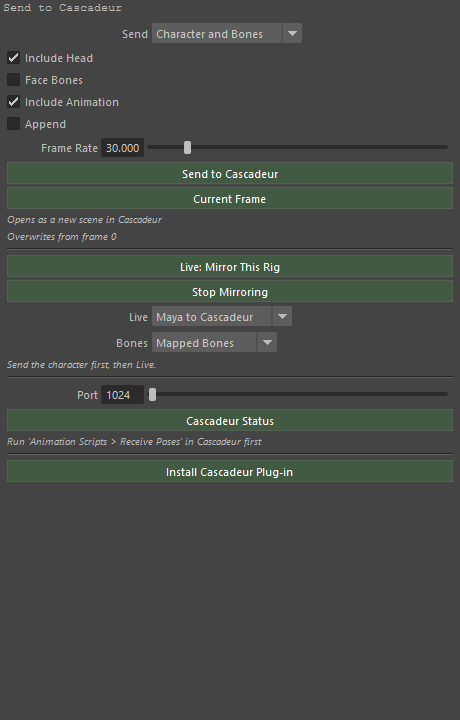</a>

localhost 포트 둘, MetaBridge Live 자체의 것입니다. `9584`가 캐릭터와
포즈를 받고, `9586`이 라이브 링크입니다. 다른 Cascadeur 브리지가 쓰는
포트가 아니라서 함께 돌릴 수 있습니다. 머신 밖으로 나가는 것은 없습니다.

1. **Install Cascadeur Plug-in**을 한 번 누릅니다. 플러그인(**MetaBridge Live**,
   파일 두 개)은 `third_party/MetaBridgeLive`에 들어 있습니다. Cascadeur는
   자기 설치 폴더 안에 스크립트를 두고, 보통은 관리자 권한이 필요합니다 —
   설치기는 짧게 살다 사라지는 도우미로 복사하고 무슨 일이 있었는지
   보고합니다. 권한 요청을 거절하면 반쯤 설치된 상태 대신 그렇게
   말합니다.
2. 무엇을 보낼지 고릅니다: **Send**(*Character and Bones* 또는
   *Keyframes Only*), **Send Head**, **Face Bones**, **Send Anim**,
   **Append**, **Frame Rate**.
3. **Send to Cascadeur**(씬 전체, Cascadeur에 새 씬으로 열림) 또는
   **Current Frame**(한 프레임, 0 프레임부터 덮어씀)을 누릅니다.
4. Cascadeur를 다시 시작한 뒤 세션마다 한 번
   `Animation Scripts > MetaBridge Live`를 실행합니다(다시 실행하면
   멈춥니다). **Cascadeur Status**가 듣고 있는지 답합니다.

**Live: Mirror This Rig**는 애니메이션하는 동안 프레임을 보내고,
**Stop Mirroring**이 멈춥니다. **Live Way**와 **Live Bones**가 미러
프레임이 무엇을 담을지 정합니다. 캐릭터를 먼저 보내고 라이브로
가세요.

**의상도 캐릭터와 함께 나갑니다.** 캐릭터 조인트에 스킨된 모든 메시(Bind
Garment가 기록한 의상과 리그에 묶인 것)가 같은 FBX에 담겨 Cascadeur에서 포즈를
따라갑니다. 의상은 복사본에서 그 아래의 몸과 머리로부터 웨이트를 새로 입힙니다 -
후드는 머리를, 헐렁한 바짓단은 자기 다리를 따라갑니다. 원본은 건드리지 않고,
머리 파트의 목·어깨 깃은 몸의 웨이트를 써서 목에서 머리가 이어집니다.
캐릭터는 **레스트 포즈**로 보낸 뒤 포즈가 따라가게 하세요(포즈를 취한 채 보내면
Cascadeur에서 의상이 찢어질 수 있습니다). 17만 버텍스 의상은 약 30초 걸립니다.

캐릭터는 **하나의 스켈레톤**으로 나가고(헤드 파트의 메시가 바디 조인트에
다시 묶입니다), 돌아온 애니메이션은 **두 파트 모두**에 들어갑니다. 헤드
쪽에 있는 같은 이름의 몸통 체인(`spine_04`부터 `head`까지, 쇄골과
상완 — 바디와 같은 레스트 변환)을 바디 조인트에서 그대로 가져오기
때문에, 헤드와 얼굴이 레스트 포즈로 서 있지 않고 함께 따라옵니다.
옆에 헤드 파트가 없는 캐릭터는 아무 영향이 없고, 얼굴 자체도 그대로
DNA의 RigLogic이 구동합니다.

## 14. Unreal Engine

<a href="assets/panel_unreal_live.png">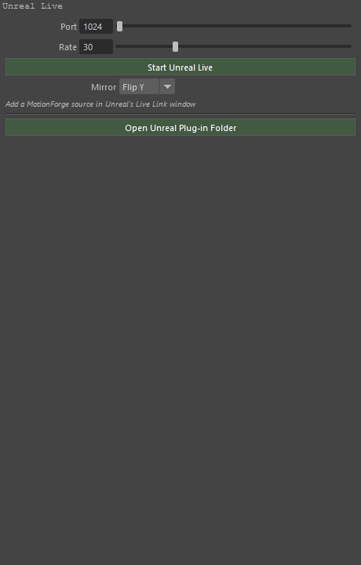</a>
<a href="assets/panel_unreal_follow.png">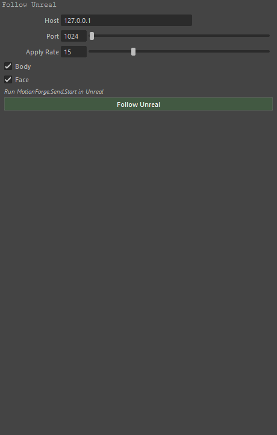</a>

**나가는 쪽(9561)** — **Open Unreal Plug-in Folder**를 한 번 누르면
처음에는 GitHub에서 `MotionForgeLiveLink`를 받아 오고, 그것을 프로젝트의
`Plugins` 폴더에 복사한 뒤 에디터를 다시 시작합니다. Unreal의 **Live
Link** 창에서 **MotionForge** 소스를 추가하고(포트 9561), 캐릭터
블루프린트에서는 **Use Live Link를 꺼 둡니다**. 그다음 **Start Unreal
Live**를 누르면 작업하는 동안 얼굴이 스트리밍됩니다 — 양쪽에서 같은
RigLogic이 돌기 때문에 건너가는 것은 컨트롤 값뿐이고, 설정한 **Rate**로
한 틱에 작은 프레임 하나입니다. **Mirror**가 스트림이 무엇을 담을지
정합니다.

**들어오는 쪽(9562)** — **Follow Unreal**은 Unreal이 애니메이팅하는
MetaHuman을 이 캐릭터가 따라가게 합니다. **Host**, **Port**, **Rate**,
**Body**, **Face**가 무엇을 따라갈지 정하고, 매 프레임의 관절별 회전과
위치 오프셋이 따라가기 시작할 때 잡은 레스트 포즈에 대한 델타로
적용됩니다 — 그리고 멈추면 되돌려 놓습니다. Unreal에서
`MotionForge.Send.Start`를 먼저 실행하세요.

## 15. 애니메이션 베이커, 포즈 리셋, 프리셋 변환기, 리타겟

<a href="assets/panel_anim_baker.png">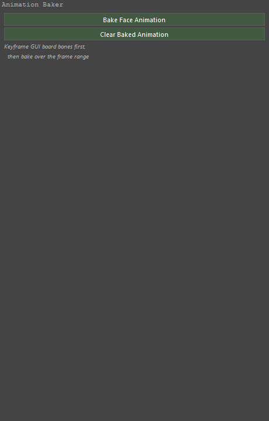</a>

**Animation Baker** — 얼굴 보드의 컨트롤을 키잉한 뒤 **Bake Face
Animation**으로 프레임 범위를 굽습니다. **Clear Baked Animation**이 그
베이크를 다시 뺍니다. (패널의 안내 문구가 순서를 말합니다: 보드를 먼저
키잉하고, 그다음 굽습니다.)

<a href="assets/panel_pose_reset.png">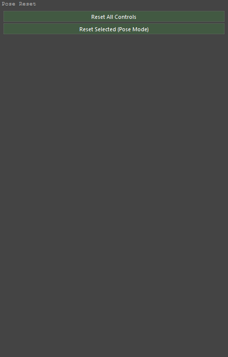</a>

**Pose Reset** — **Reset All Controls**는 얼굴 보드 전체를 중립으로,
**Reset Selected**는 선택한 컨트롤만 되돌립니다. 포즈 작업 도중에
필요한 것은 후자입니다.

<a href="assets/panel_preset_converter.png">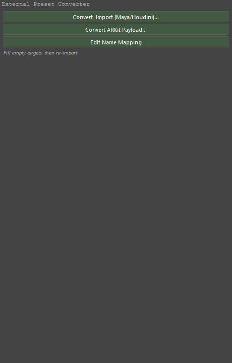</a>

**External Preset Converter** — 남의 프리셋은 **본** 이름을 쓰고 보드는
**컨트롤** 이름을 쓰므로, 둘을 `name_mapping.json`으로 맞춥니다.
**Convert & Import (Maya/Houdini)…**는 그 툴의 프리셋을,
**Convert ARKit Payload…**는 ARKit 페이로드를 가져옵니다. **Edit Name
Mapping**은 다시 가져오기 전에 비어 있는 대상을 채우려고 매핑을
엽니다.

<a href="assets/panel_rig_retarget.png">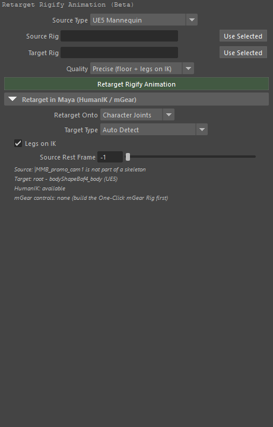</a>

**Retarget Rigify Animation** — 다른 리그의 애니메이션을 이 캐릭터로
가져옵니다. **Source Type**이 프로파일을 고르고(*Auto Detect*, *UE5
Mannequin*, *Fortnite*, *MetaHuman*, *Mixamo*, *Rigify*부터 *SMPL-X*,
*SOMA*, *Unitree G1*까지 열다섯 개), **Source Rig** / **Target Rig**가
두 리그를 가리키며, **Quality**가 해를 고릅니다: *Precise (floor + legs
on IK)*, *Balanced (legs on IK)*, *Fast (rotations only)*.

애드온의 행들 아래에는 포트 자체의 프레임 **Retarget in Maya (HumanIK /
mGear)** 가 있고, 결과가 어디로 가는지가 여기서 정해집니다.

- **Retarget Onto** — 캐릭터 자체의 **관절**(캐릭터 스켈레톤에 맞춘 해:
  레스트 포즈 정렬, 루트 이동 스케일, 발은 IK, 바닥 맞춤), **HumanIK
  (Maya)**(두 리그를 HIK 캐릭터로 정의하고 마야 자체 리타겟을 굽기),
  또는 원클릭 **mGear Controls**.
- **Target Type**은 캐릭터 쪽에서 어느 리그를 쓸지, **Legs on IK**는
  발을 회전시키는 대신 바닥에 붙일지, **Source Rest Frame**은 소스
  테이크의 어느 프레임을 *레스트 포즈*로 볼지(`-1`이면 해가 알아서
  판단) 정합니다.

## 빠른 팁

- **패널이 하는 일은 커맨드도 합니다.** 모든 버튼이 마야 런타임
  커맨드입니다: 스크립트 에디터, MEL 스크립트, 셸프 버튼에서
  `cmds.mmb_mh_assemble()`. 마야가 버튼에 보여 주는 툴팁이 그 버튼이
  어떤 애드온 기능인지, 그 뒤의 작업이 이식됐는지 말해 주고, 커맨드
  이름은 [패널 레퍼런스](KO_panels.md)에 버튼마다 적혀 있습니다.
- **설정은 optionVar**이고 `mmb.` 접두사가 붙습니다. 이름은 애드온의
  프로퍼티 이름 그대로입니다(Textures 체크박스는
  `mmb.ml_mh_load_textures`). 마야를 다시 시작해도 남고, MEL에서도
  설정할 수 있습니다:
  `optionVar -iv "mmb.ml_mh_load_textures" 0;`
- **Python에서는** `mmb.api`가 파사드입니다:

  ```python
  import mmb.api as api
  api.status()                # 애드온의 얼마나 이식됐는지
  api.panels()                # 18개 패널, 사이드바 순서
  api.window()                # 허브 열기
  api.run("mmb_mh_assemble")  # 버튼 하나 실행
  ```
- **배치 호스트**: 창이 필요한 기능은 `mayapy`에서 거절하고 그렇게
  말합니다. 필요 없는 작업 — 어셈블, 경로를 준 내보내기, 검증, 베이크 —
  은 그대로 동작하고, 포트의 자체 테스트도 그렇게 돕니다
  (`tests/run_tests.py`).
- **씬에 숨은 것이 없습니다**: 캐릭터는 평범한 관절과 메시의 그룹이고,
  슬롯 목록은 데이터를 담은 네트워크 노드(`MMB_Slots`) 하나이며, 나머지
  설정은 optionVar입니다 — 플러그인이 저장한 씬은 플러그인 없이도 열립니다.

## 포팅의 한계

- 애드온의 **143개 커맨드 중 124개**를 이식했습니다. 남은 19개는
  **18개 패널 id**(애드온의 패널 클래스이고 마야에 대응물이 없습니다 —
  포트는 자기 창을 그립니다)와 **`mmb_save_mat_defaults`**,
  *Save Material as Default*입니다. 이것은 블렌더의 Principled BSDF
  소켓 값을 캡처하는데, 포트의 재질은 Arnold `standardSurface` 노드라
  애트리뷰트 이름이 완전히 다릅니다. 게다가 아직 그런 파일을 **읽는
  단계가 없어서**, 쓰기만 하면 아무도 읽지 않는 파일을 만드는 버튼이
  됩니다. *(Reload Materials*와 *Reset Material Defaults*는 있습니다.)*
- **포트는 실패를 말합니다**: 일을 할 수 없는 커맨드는 왜 그런지
  스크립트 에디터에 쓰고, 가능하면 뷰포트에도 말합니다 — 아무것도 바뀌지
  않는 대신입니다.
- **Cascadeur 관리자 권한 설치**는 구현되어 있고 계획 단계는 테스트되어
  있지만, 권한 상승이 필요한 실제 설치(Cascadeur가 `Program Files`에
  있는 경우)에 대해서는 아직 실행해 보지 못했습니다. 사용해 봤다면 어떤
  일이 있었는지 알려 주세요.
- 이 가이드의 스크린샷은 Windows의 마야 **2027**과 기준 MetaHuman에서
  찍었습니다. 메뉴 문구와 창 장식은 다른 시스템에서 다를 수 있고, 패널은
  같은 패널입니다.

## 패널 레퍼런스

패널마다 무엇을 위한 것인지와 그리는 컨트롤 전부 — 플러그인 자체의
레지스트리에서 생성했습니다:

- **[패널 레퍼런스](KO_panels.md)** (한국어)
- **[Panel Reference](panels.md)** (English)
