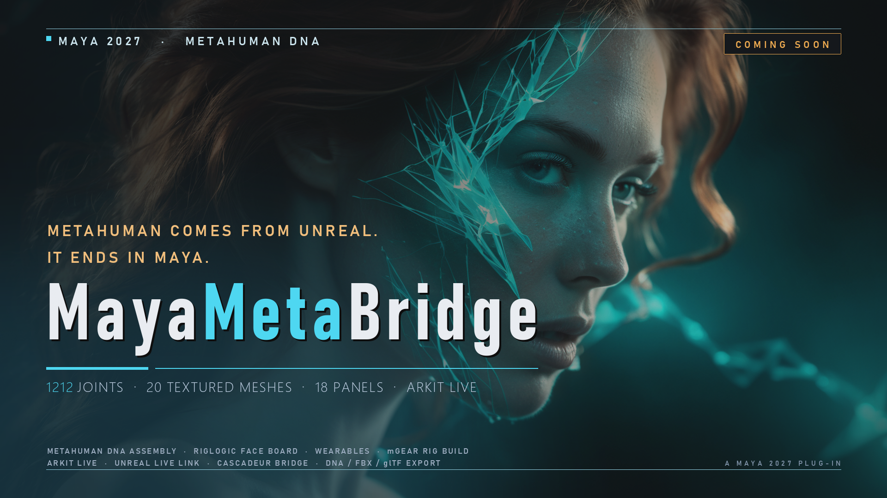
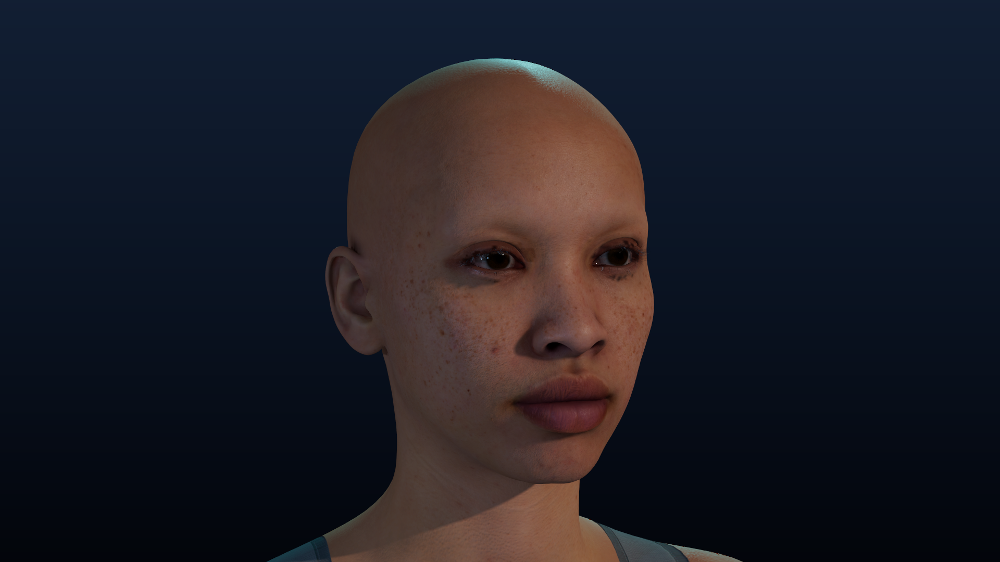
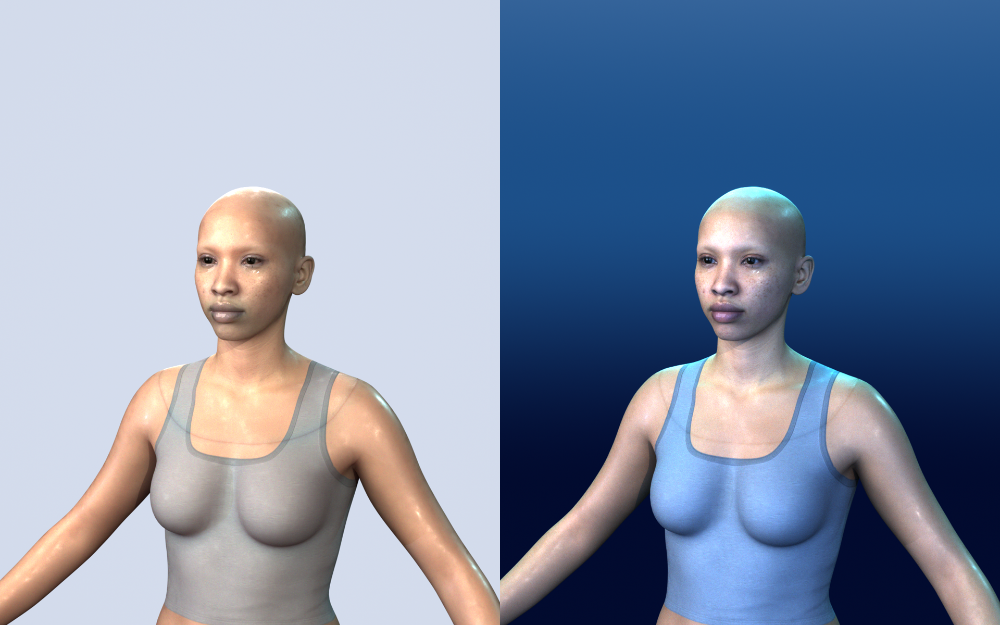
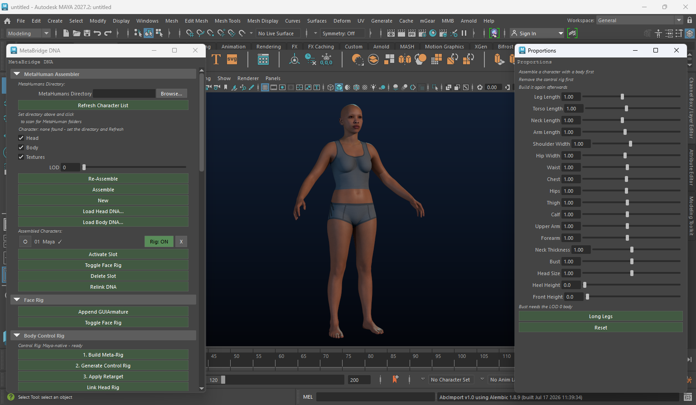
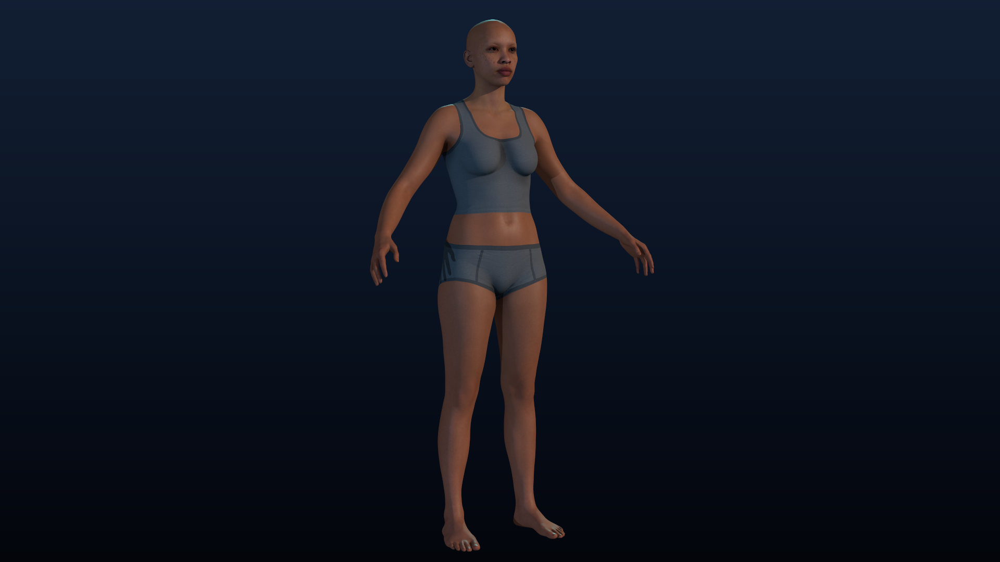
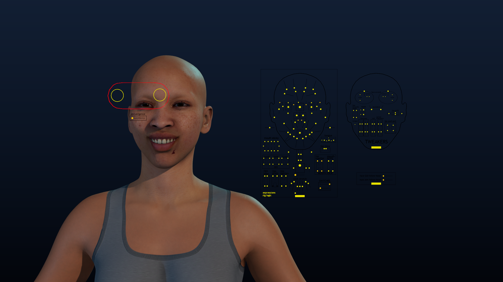
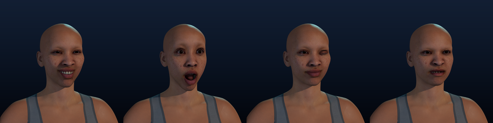
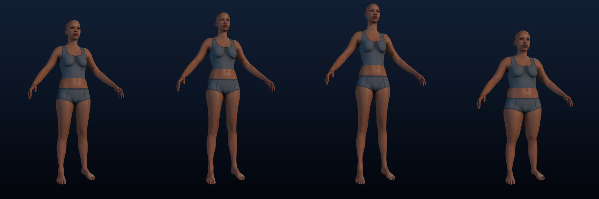
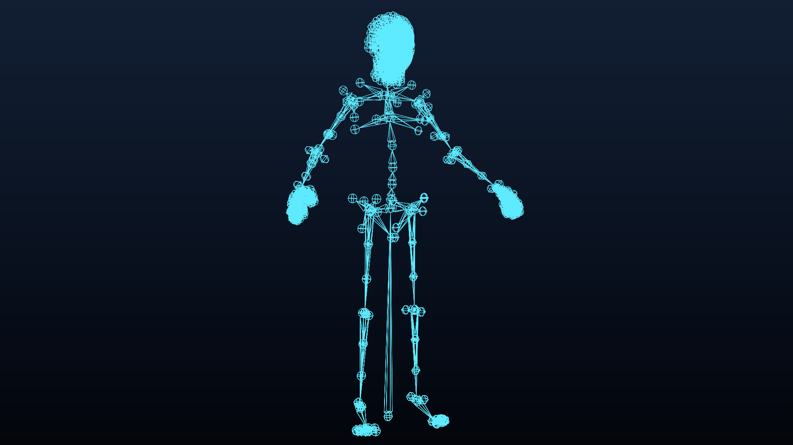

# MayaMetaBridge — User Guide

🇺🇸 English | [🇰🇷 한국어](./KO_index.md)

MayaMetaBridge (MMB) brings Epic Games **MetaHuman** characters into Maya 2027:
assemble one from its DNA files, drive the face, reshape the body, dress it, rig
it with mGear, and send it out to Unreal Engine, Cascadeur, Marvelous Designer
and ARKit.

It is a port of the Blender add-on **MetaBridge DNA** — the same DNA files, the
same RigLogic face rig, the same rules — reached through `maya.cmds` and
OpenMaya. The panels, their rows and their buttons come from that add-on, so
between the two guides the same panel is the same panel.

<a href="assets/wide_en.png"></a>

<a href="assets/shots/hero_face.png"></a>

*The face above is the plug-in's own output: a MetaHuman assembled from
`head.dna` and `body.dna` in a Maya 2027 viewport, wearing the maps from its own
`Maps` folder. No stand-in render.*

## See it in action

Every picture and clip in this guide is a Maya 2027 session with the bundled
reference character - the viewport drawn by Maya, the dials moved by the
plug-in. Where a picture was touched after Maya drew it, its caption says so.

<p align="center">
<video src="assets/video/expressions.mp4" width="760" controls autoplay muted loop playsinline></video>
</p>

*The face board (§2) and expression presets (§3): four ARKit expressions
blended in and out - the dials on the board move, and RigLogic moves the
head's joints with them.*

<p align="center">
<video src="assets/video/turntable.mp4" width="300" controls autoplay muted loop playsinline></video>
&nbsp;
<video src="assets/video/proportions.mp4" width="300" controls autoplay muted loop playsinline></video>
</p>

*Left: the assembled character, textured, turning in the viewport. Right: the
proportion sliders (§5) - the reset body, **Long Legs**, a taller build and a
heavier one - eased into each other.*

<a href="assets/shots/lookdev_styles.png"></a>

*The Arnold Look-Dev (see **What's new**) on the same character, both
rendered by Arnold from the button's own camera and light rig, each exposed by
its own measured probe: **Realistic** on the left, **Stylized Blue** on the
right. Only the light, the backdrop and how the materials take it differ - the
character is the same.*

## What's new

**v0.2.0 — characters, clothes and Cascadeur**

*Added*

- **Several characters at once** — every assembled character keeps its own
  face board (a namespace per character), its own thumbnail in the
  character gallery, and a row in the **Assembled Characters** list with a
  Rig ON/OFF switch. The `Character` pick and the Active Slot decide which one
  every command works on, and moving a character no longer resets it when you
  turn a face dial.
- **Clothes go to Cascadeur with the character** — whatever is bound to the rig
  is sent as clean skinned copies (weights taken from the body and head), so the
  clothes follow the legs and arms instead of tearing. **Clothes Detail**
  (Full / Half / None) keeps Cascadeur's memory in check: a 170,000-vertex coat
  is most of what Cascadeur holds for a character.
- **One Cascadeur scene per character** — sending a second character opens a new
  scene instead of overwriting the first. **Live: Mirror This Rig** is one global
  switch, and the **Active Slot** picks which character talks to Cascadeur.
- **Look Style for the Arnold Look-Dev** — *Realistic* (the beauty rig) or
  *Stylized Blue*: cyan rim and blue fill light, a glowing blue backdrop, smooth
  bright porcelain skin, a glossy outfit, stronger bloom and a light colour
  grade. Only light, backdrop and how materials take it change - never the
  character. Switching back restores the materials.
- **Clothing that follows the body** — **Bind Garment** adopts the rig, flattens
  history, transfers weights and fits the garment; imported clothing attaches
  itself; worn garments are found again when a scene is reopened.

*Fixed*

- Clothes did not follow **Body Blend** and sank into the skin when the body
  changed: garments are now carried with the blended body and pushed back out
  of the skin (**Refit Clothing To Body**, **Fit Clothing to Skin**).
- Garment weights were wrong (clothes tore when a leg moved, the head ring of a
  top stayed behind); the head and body were disconnected after a send.
- Pressing a second Assemble dropped the face rig; a new DNA folder or a fresh
  Maya session did not list the new character; the Active Slot window flickered
  and did not apply to the picked character.
- Bind Garment raised `_smooth_over_mesh() missing 2 required positional
  arguments`.
- **Arnold Look-Dev**: the first press framed the camera for the scene's old
  resolution (a long shot where a bust was asked for) - it now sets the render
  size first; the exposure measurement needed Pillow, which Maya does not ship,
  so on most machines the rig stayed at its blown-out design values - it now
  reads the probe with Maya's own `MImage`; and each character's face board
  (they live in a namespace per character now) was left in the render.
- The character thumbnail was missing in the Assembly list.

*Guide*

- The guide now shows the character in a Maya viewport - stills, a Maya window
  with the plug-in's panels, an Arnold look-dev comparison - and short clips:
  the face board playing expressions, a turntable, and the proportion sliders.
  See **See it in action**.

*Faster*

- Sending with clothes, refitting and the live Body Blend preview are faster
  (lean nearest-point search, float matrices, changed-joints-only
  face writes, deferred refit while dragging).

*Upgrading from 0.1.0*

- Press **Install Cascadeur Plug-in** once and restart Cascadeur: the plug-in
  is now MetaBridge Live 1.1, the one with a scene per character. With the old
  one a second character replaces the first one's scene - Maya says so when it
  sends.

**v0.1.0 — the Maya port**

- **Assemble** — a MetaHuman folder in, a rigged, textured character out. In
  the reference character this guide's pictures come from: **1212 joints**
  (870 in the head, 342 in the body) and **17 maps** from its own `Maps`
  folder wired through 20 materials.
- **The face board** — Epic's own picker, built from the plug-in's own
  `faceboard.json`, so the dials are the ones the character expects.
- **124 of the add-on's 143 commands** are ported, across all 18 panels and all
  122 buttons those panels draw. The 19 that are not are the 18 panel ids plus
  one operator (`mmb_save_mat_defaults`, see [Limits](#limits-of-the-port)).
- **Hair as an XGen groom** — an Alembic groom comes in as *one* XGen
  interactive-groom description on the head (not a node per strand), with a
  guides / strands choice, a live preview you drag to line it up, and a bind
  that makes it follow the head. See [Wearables](#8-wearables-clothing-and-hair).
- **ARKit that matches the rig** — head rotation about the world's axes, a
  *Calibrate Neutral Face* button, and the blink, tongue, cheek-puff and "oo"
  corrected against what the rig actually does. See
  [ARKit Live](#4-arkit-live-the-iphones-face).
- **Body Blend, the add-on's way** — a source list with thumbnails, a primary
  row, head blending, a character built into a registered slot, and a live
  preview; and **Expression Presets as sliders** that blend. See
  [Body Blend](#7-body-blend).
- **Arnold Look-Dev** — the port's own scene to look at a character in: an
  Arnold twin of every material (**the XGen groom's hair included**, which used
  to be the one part of a character the port could not shade), a five-light
  beauty rig with a sky dome, an 85 mm bust and a 50 mm full-figure camera, and
  the render settings a still is normally shot at - rendered on the **GPU**,
  with the CPU as the fallback. Two things Arnold's GPU cannot do are handled
  rather than discovered: a groom is given an `aiStandardHair` (Maya's own
  `hairPhysicalShader` has no GPU implementation at all, and MtoA answers that
  by crashing the whole session), and adaptive sampling is turned **off** for
  the GPU, because MtoA 5.6.2 crashes on it instead of refusing it. The press
  also **exposes the rig**, which is the difference between a lit character and
  a white blob: it renders a small probe of the face, reads the skin's own
  brightness in the display space the RenderView shows, and moves the rig (the
  sky dome included, since that is what lights a face here) until the lit cheek
  lands on the reference still's own measured skin - 0.59 median / 0.79 at its
  75th percentile - while what the camera sees of the dome stays where the
  design put it, so the backdrop does not go dark with it. Measured on a real
  character, the design values read 1.00 in the face box and the press lands
  them at 0.61 / 0.78 with no clipped pixels, against the reference's 0.59 /
  0.79 and a 0.84 backdrop. The three rows are in the main panel's **Arnold
  Look-Dev (Maya-only)** frame.
  **Look Style** (same frame): *Realistic* is the beauty rig above; *Stylized
  Blue* gives the cool, glowing mood of a blue/white sci-fi key illustration -
  cyan rim and blue fill light, a glowing blue backdrop, smooth bright porcelain
  skin (less scattering, a soft clear-coat sheen), a glossy outfit, a stronger
  bloom and a light colour grade. It changes only the light, the backdrop and how
  the materials take it - never the character's mesh, maps or colours. Pick it,
  press **Arnold Look-Dev** again, and switch back the same way.
- **mGear, one click** — the port's own feature, not a port of anything: the
  Blender add-on rigs with Rigify, and Maya has mGear. The click places mGear's
  MetaHuman guide on the character's joints and builds the Shifter rig over it,
  then binds the head so the face follows the body.

## What is this plug-in?

With it you can:

- Load a MetaHuman character (head + body) into Maya from its `.dna` files
- Move the face board's dials, or drive the face from an **iPhone**, live
- Save expressions as presets and blend several at once as sliders
- Reshape the body with proportion sliders — the DNA follows the sliders
- Blend several bodies into a new one
- Put clothing, hair and accessories on the character, and keep them on
- Build an animatable body rig with **mGear**, and retarget animation onto it
- Sculpt correctives on the skin and sync them to worn clothing
- Export everything back to **DNA**, **FBX** or **glTF**

There is no **N panel** in Maya. The add-on draws eighteen panels down one
sidebar; here each panel is a window of its own, and there are two ways to reach
them: the **MMB** menu in Maya's menu bar, and the hub (**Show MMB Window**),
which lists every panel and says how much of the port is done.

## Installing

1. Unzip this folder anywhere you keep tools. **The folder is used where it
   is** — do not move it afterwards.
2. Run the installer with Maya's Python (or any Python 3):

   ```
   python installer/install.py
   ```

   Add `--maya-version 2027` if you have more than one Maya installed, and
   `--remove` to take it out again.
3. Restart Maya. The **MMB** menu appears in the menu bar.

What the installer touches is one block in your Maya preferences —
`<prefs>/scripts/userSetup.py` — which defers one `loadPlugin` to the first
idle. Your previous `userSetup.py` is kept beside it as
`userSetup.py.bak-mmbb`, and the block is replaced rather than appended, so
running the installer twice is the same as running it once. It does not touch
`Maya.env`, your modules folder, or anything else in the preferences.

To load it for one session only, run this in the Script Editor:

```python
import maya.cmds as cmds
cmds.loadPlugin(r"<this folder>/mmb_plugin.py")
```

Maya needs **2027** (Python 3.13), Windows 64-bit. The DNA and RigLogic
libraries for Windows are bundled in `mmb/lib`, so nothing else has to be
installed.

### The menu

<a href="assets/menu.png"></a>

Eight entries and two dividers: the hub, then the six things a character
actually needs, then **All Panels**. `Assemble a MetaHuman` **opens the
assembler** rather than building straight away — the button that builds is in
the panel, where the character to build is picked and where a click that would
rebuild the character under you can say so instead.

<a href="assets/menu_all_panels.png"></a>

Under **All Panels** every panel is one item, grouped the way the hub's Pro view
groups them: **Character**, **Face & Animation**, **Body Rig & Sculpt**,
**Live Links**, **Assets & Export**. Each item opens that panel's own window;
the menu does not draw its buttons a second time.

### The hub, and two views of it

**Show MMB Window** opens the hub. Its first control is the view:

<a href="assets/hub_simple.png"></a>
<a href="assets/hub_pro.png"></a>

*Simple (left) is six numbered steps in the order the work happens — assemble,
reshape, try on expressions, add clothing, record, export — and one button to
the whole list. Pro (right) is all eighteen panels grouped by what they are
for, each row saying how many buttons it holds. The line under the switch is
the port's own progress — `18 panels, 122 buttons, 90 settings —`
`124 of 143 commands` — and the view you leave it in is remembered.*

<a href="assets/maya_window.png"></a>

*The port's windows are ordinary Maya windows: they dock where you drop them,
and a saved Maya layout brings them back (each one restores through its own
`uiScript`).*

<a href="assets/shots/workspace.png"></a>

*Two of them over the character: the assembler and the proportion sliders.
This is the shape of a session — the character in the viewport, the panel you
are working in beside it.*

### Plug-ins for the other programs

Four features reach into a program outside Maya, and each needs something on
that side.

| Program | What it is | Needed for |
| --- | --- | --- |
| mGear | your own install — put its `scripts` folder on `MAYA_MODULE_PATH` | **One-Click mGear Rig**, the Anim Picker (§6) |
| Cascadeur | the `third_party/MetaBridgeLive` folder | **Send to Cascadeur** (§13) |
| Unreal Engine | `third_party/MotionForgeLiveLink`, or downloaded on first use | **Unreal Live**, **Follow Unreal** (§14) |
| Marvelous Designer | the `mmb/md_plugin` folder | **MD Live** (§12) |

Cascadeur's and Marvelous Designer's plug-ins **come with this package** —
nothing to download. The Unreal one is fetched from GitHub the first time you
press **Open Unreal Plug-in Folder**; needs an internet connection just that
once. Install none of them to start with: each section below sets up its own
when you get there.

## 1. Assembling a MetaHuman

<a href="assets/panel_main.png"></a>

1. In **MetaHumans Directory**, pick the folder your MetaHumans live in — the
   one with `head.dna` inside. A folder is a character when it holds
   `head.dna`; pointing at a character folder also lists that character's own
   siblings.
2. Press **Refresh Character List** and pick the character.
3. Leave **Head**, **Body** and **Textures** on. **LOD** chooses which mesh
   level to load — 0 is the fullest, and the only level the **Bust** slider
   works on (§5).
4. Press **Assemble**.

The character arrives as ordinary Maya nodes: a skeleton, skinned meshes with
their materials wired to the `Maps` folder beside the DNA, and the **face
board** (§2). Measured on the reference character this guide's pictures come
from: **1212 joints** (870 in the head part and 342 in the body), and **17
maps** wired through 20 materials.

<a href="assets/shots/hero_full.png"></a>

Under the folder field, **Character** is the pick of the characters the folder
holds; **Assemble** builds the one it shows. (A folder that is itself a
character folder is that character.)

**Assembled Characters** is the add-on's list, one row per character in the
scene - its head and body parts are one row:

- the round button on the left **activates** it (most of the plug-in works on
  the active character, and the row says which slots it holds),
- **Rig: ON / OFF** puts the character's own face board in the scene, or takes
  it out - every character can have its own board at the same time, and
  dialling one moves that character's face and no other,
- **X** deletes the character's slots,
- the mark after the name says whether its nodes are all still in the scene.

The buttons under the list (**Activate Slot**, **Toggle Face Rig**,
**Delete Slot**) do the same for the character they are given, and **Relink
DNA** re-points a slot at its DNA file after the file moved. **Load Head DNA…**
and **Load Body DNA…** bring a single part in on its own.

Two more things in the panel worth knowing: **Re-Assemble** is the same command
as **Assemble** (it is there because a slot that drifted halfway through the
work is the reason to press it), and the **mGear Rig** frame at the foot of the
panel is §6.

## 2. The face board

<a href="assets/shots/face_board.png"></a>

*The board and the face it drives: the dials a smile moves, and the head following them.*

Assembling a MetaHuman leaves more in the scene than a rig: a **face board
(picker)** beside the head, one control per facial expression. It is Epic's own
board, not the port's invention — the plug-in builds it from the same
`faceboard.json` its Maya plug-in uses (175 GUI controls and 3 analog ones,
each with its shape, colour, limits and slider track), so a jaw you open here
is the jaw the character's RigLogic expects.

Dial values on the board are the interface everything else uses:

- **ARKit Live** (§4) drives them from your iPhone,
- **Expression Presets** (§3) save and reapply them,
- **Animation Baker** (§15) bakes them over the frame range,
- **Pose Reset** (§15) puts them back to neutral,
- and the **RigLogic face rig** evaluates them, which is what makes the skin
  move — there are no shape keys to edit.

**Toggle Face Rig** (main panel, Face Rig frame) shows the board and hides it
again; **Rig: ON / OFF** on a character's row (§1) does it for that character.
Each character has a board of its own: the board is built into a namespace
named after the character (`mmbFace_<name>:`), so two characters' boards never
share a node. The board moves the **face only** - a character you have moved or
posed by hand stays where it is while you dial. While the body is on a rig (§5
or §6) the head part follows it: a character whose head is not linked turns
its face and not its head.

**The RNA list** (main panel, *RNA* tab) lists the DNA's raw-control channels
beside the control that drives each one. **View** switches between the DNA
view (one row per channel: `rc#`, the channel, the connected control and
*Connect* / *Change* / *x*) and the Bone view (one row per control with its
channels); **Filter**, **Show** (All / Mapped / Unmapped), **Parent** and
**Per Page** narrow it and the list redraws as you change them, with **< Prev /
Next >** for pages. *Connect* asks for a control and stores the mapping with
the character; **Clear All** drops every manual mapping and puts the channels
back on their own controls. A body-only DNA has no face channels, and the list
says so.

## 3. Expression presets

<a href="assets/shots/expressions.png"></a>

*A smile, a surprise, a wink and a frown - each one ARKit preset blend, applied from the panel.*

<a href="assets/panel_pose_presets.png"></a>

A preset is a JSON file of the face board's dial values, keyed by control name,
so it travels between scenes and machines.

- **Save Current Expression** writes the board's current values over the preset
  picked in the list; **Save As Current Expression…** writes a new one.
- **Apply Preset** does **not** snap the face to that pose: it adds the preset
  to the slider list at `1.0`, and the face becomes the blend of every slider
  in that list. Two presets that open the same jaw do not add up past the bigger
  one — the blend takes the largest contribution per control.
- **Add All From Active Folder** adds every preset in the folder at `0.0`, so a
  folder becomes a bank of sliders you fade in.
- **Clear All Sliders** empties the list and puts the face back to neutral;
  **Delete Expression Preset** deletes the file; **Set Folder…** and **Open
  Presets Folder** work on the folder the presets live in.

The **ARKit presets ship with the plug-in**: `mmb/presets/ARKit`, one
`ARKit_<name>.json` per blendshape, with the name mapping beside them. That
mapping is what ARKit Live (§4) drives.

## 4. ARKit Live — the iPhone's face

<a href="assets/panel_arkit_live.png"></a>

Apple's **Live Link Face** app streams the 52 ARKit blendshapes over UDP as
big-endian floats. The plug-in receives them on a background socket, and the
scene is touched on the idle job — Maya's main thread.

1. In Live Link Face, point the stream at this machine (the app's default port
   is **11111**, which is what the panel is set to).
2. **Host** `0.0.0.0` takes the stream on every interface; change it to pin one.
3. **Connect**. The face follows as you talk.
4. Tune with **Smoothing** (`0.5`), **Deadzone** (`0`) and **Gain** (`1.0`),
   which are applied per blendshape exactly as the add-on applies them.

**Record** records what is applied as keys; **Load Live Link Face CSV…** takes
the app's own recording instead (one row per frame), and **Export Face CSV…**
writes the current face out the same way. **Export ARKit Blend Shapes (FBX)…**
writes an ARKit-named blendshape set as FBX for other tools, and **Rebuild Name
Mapping** rebuilds the mapping between ARKit names and the board's controls when
a character arrives with a naming that does not match.

**Head Rotation (Experimental)** turns the character's head from the phone's
head pose: pitch nods about the world's X, yaw turns about Y and roll tilts
about Z, on top of the head's own orientation. Use **Invert Pitch / Yaw /
Roll** if a direction is the wrong way round for the way the phone is held.

**Calibrate Neutral Face** — a phone never reads a relaxed face as zero: the
mouth-shrug, roll and stretch shapes each sit at 0.1–0.3 and together open the
mouth a little, and a relaxed eye reads as `eyeWide` 0.4. Relax, mouth closed,
eyes as you normally hold them, and press it: the average of a second of
frames becomes the resting face, every shape is measured from it, and a
slightly narrower eye (a *smaller* `eyeWide`) now closes the lids a little
instead of being lost. **Clear Neutral Calibration** forgets it. It is kept
with the settings.

Four shapes are corrected for this rig, because the add-on's presets and the
board's DNA put some controls the other way round (36 channels, among them the
blink and the tongue's in/out): the **blink** closes the lids and *eyeWide*
opens them, **tongueOut** puts the tongue out, **cheekPuff** blows the cheeks
with the lips sealed (the preset also blew the lips forward), and
**mouthPucker** narrows the mouth through the corner controls so an "oo"
reads as one.

## 5. Proportions

<a href="assets/shots/proportions.png"></a>

*The same character through the sliders: reset, **Long Legs**, a taller build, a heavier one.*

<a href="assets/panel_proportions.png"></a>

Eighteen sliders, all factors on the character as it was built, with `1.0` being
that character. **A slider that moves moves the character** — there is no Apply
button, the same as in the add-on.

| Group | Slider | Range |
| --- | --- | --- |
| Length | Leg Length | 0.80 – 1.30 |
| Length | Torso Length | 0.85 – 1.20 |
| Length | Neck Length | 0.80 – 1.30 |
| Length | Arm Length | 0.85 – 1.20 |
| Width | Shoulder Width | 0.85 – 1.20 |
| Width | Hip Width | 0.85 – 1.20 |
| Width | Waist | 0.75 – 1.30 |
| Width | Chest | 0.80 – 1.25 |
| Width | Hips | 0.80 – 1.25 |
| Width | Thigh | 0.75 – 1.30 |
| Width | Calf | 0.75 – 1.30 |
| Width | Upper Arm | 0.75 – 1.30 |
| Width | Forearm | 0.75 – 1.30 |
| Width | Neck Thickness | 0.80 – 1.25 |
| Shape | Bust | 0.50 – 1.50 — needs the **LOD 0** body |
| Size | Head Size | 0.90 – 1.10 |
| Shoes | Heel Height | 0 – 15 cm |
| Shoes | Front Height | 0 – 5 cm |

What the sliders do, and what they deliberately do not:

- lengths stretch a **segment** by moving the joint at its end, never by scaling
  a bone — a longer thigh is not a fatter one;
- widths move the joint the width is measured at, and the hip keeps only its
  left-right offset scaled;
- the whole body rides with the feet, so longer legs lift the character instead
  of pushing the soles through the floor;
- the skin follows through its own **skinning**, which is what a Maya character
  does when its joints move, and the mesh fields (girths, bust, shoes, head)
  come on top of the same bone moves;
- every change is worked out from the rest skeleton **again**, so nothing drifts
  and setting a slider back to `1.0` gives the original character back exactly.

**Long Legs** sets the one-click look the add-on has; **Reset** puts every
slider back.

Two things the panel says and means: assemble a character **with a body**
first, and if a control rig (§6) is standing over the character, remove it
before reshaping and build it again afterwards.

## 6. The body rig — mGear, one click

<a href="assets/shots/rig_joints.png"></a>

*The character's own skeleton — 1212 joints — which any body rig is built over. The skin is hidden and the joint lines are repainted cyan: Maya draws joints in a dark violet that disappears on this backdrop.*

<a href="assets/viewport_mgear_rig.png"></a>

*The same character on the rig the one click builds.*

This is the port's own feature. The Blender add-on rigs with **Rigify**; Maya
has **mGear**, and a MetaHuman user already has it installed — so the click
places mGear's own MetaHuman guide on the character's joints and builds mGear's
**Shifter** rig over it.

Put mGear's `scripts` folder on `MAYA_MODULE_PATH` first. Then, in the main
panel's **mGear Rig (Maya-only)** frame:

| Button | What it does |
| --- | --- |
| One-Click mGear Rig | snap the guide onto the character, build the rig, and bind the head |
| Snap mGear Guide | put the guide's locators back on the joints, for a guide you moved by hand |
| Bind Head to mGear Rig | constrain the head part to the body joints mGear drives (the one-click does this already) |
| Unbind Head from mGear Rig | take those constraints out again; the head keeps its values where it stands |
| Register Anim Picker | make mGear's Anim Picker for the rig — body and face pages — and open it |
| Remove mGear Rig | delete the guide and the rigs; the character stays as it is |

Two details the plug-in reports rather than hides: a guide locator whose joint
the character does not have is **left where the template put it** (and the
console says which), and a MetaHuman is **two skeletons that share joint
names** — the neck's, among others — so the other part's joints are given names
of their own while mGear connects and their own names back afterwards.

### The add-on's own rig buttons

The **Rigify Body Control Rig** frame in the main panel is the add-on's rig
workflow, and in Maya it builds a **Maya control rig** over the character's key
joints (the add-on's two steps, `1. Build Meta-Rig` and `2. Generate Control
Rig`, then `3. Apply Retarget` so the character follows it). Alongside them:

- **Remove Retarget** / **Remove Control Rig** take it back out;
- **Link Head Rig** / **Unlink Head Rig** attach the head part, which is what
  makes the face follow the body;
- **Toggle RBF Correctives (Body)**, **Driver Bone**, **Show RBF Controls** /
  **Hide** — the add-on's RBF corrective pass and its manual controls;
- **Import FBX Animation…** imports animation onto the rig;
- **Toggle IK Stretch**, **Toggle Heel Pivot**, **Toggle Finger IK**,
  **IK to FK** / **FK to IK**, **Snap Fingertip Targets** — the limb and finger
  switches, including the per-finger `0 = joints, 1 = fingertip` blend.

Retargeting an animation *from* another rig is its own panel — §15.

## 7. Body Blend

<a href="assets/panel_body_blend.png"></a>

Several bodies averaged into one new character.

A **source row** is either a body DNA file (with the head DNA that goes with
it) or one archetype of a library file, and each has a weight. One row is the
**primary** — the highlighted one — and it has to be a real DNA file, because a
library entry carries no RigLogic data of its own: the primary is what the new
character's rig is built from.

- **Use Base DNA** adds the bundled reference `Body.dna` (and `Head.dna`) as the
  primary row; **Add Body DNA** / **Add Folder…** add files at weight `0`;
  **Load Library…** adds a library's archetypes at `0`; **Export…** writes a
  library file out.
- **Build Blended Body** averages the rows that carry weight — body and, when
  every one of them has head data, head too — and builds a **new character** in
  the slot list. **Blend Active Character** applies the blend to the character
  you already have instead, and **Replace** chooses between adding and
  replacing.
- **Live Preview** is off by default: it is the switch that makes a weight drag
  show its result while you drag.
- **What the character wears follows the blend.** After **Blend Active
  Character** (and every Live Preview step) the garments worn on it are fitted to
  the new skin: they go with the bones through their skin, and wherever the new
  body reaches through the cloth it is pushed back out, the Clothing Offset kept
  (§8). **Build Blended Body** makes a new character, and what the active one
  wears is moved onto it - carried to the new character's bones, bound there and
  fitted - instead of staying behind on the old one.

## 8. Wearables — clothing and hair

<a href="assets/panel_wearables.png"></a>

- **Import Clothing (FBX)…** brings a garment in (and **Head Accessory…** the
  same for something that goes on the head) **and attaches it to the active
  character**: skinned to the character's own skeleton and fitted to its skin,
  the way the add-on does it. A garment that is only a mesh in the scene does
  not follow the body, a blend or a reshape - **Bind Garment To Character**
  attaches one that was brought in some other way.
- **Make Garment Rig**, then **Bind Garment To Character** — binding copies the
  body's skin weights onto the piece, so it moves the way the skin beneath it
  moves. Every vertex gets weights from the nearest body vertices (a
  vertex on one leg only looks at that side, so a baggy trouser leg does not
  pick up the other leg), blended over its neighbours; vertices a plain copy
  leaves at zero - nearly half of a coat modelled before its UV seams were
  split - are filled in as well. A garment whose skin was made before later
  edits (a coat with its UV seams cut afterwards) is baked first, so the
  vertices those edits added are weighted too, and a garment that came with its
  own copy of the skeleton (a clothing FBX) is carried onto the character's own
  bones - each vertex by its own weights, so the cloth is retargeted to this
  character's proportions - instead of staying behind on a skeleton nothing
  drives.
- **What counts as worn.** A mesh skinned to the character's own joints is worn
  whether or not it was recorded: Refit, Fit to Skin and the blend find it and add
  it to the list (a scene saved and opened again does not lose its clothes).
- **Fit to the skin** keeps a garment out of the character's body. A garment
  modelled over another build sinks into this one wherever the two differ; the
  fit finds, for every vertex, the nearest point of the body and head skin,
  and one that is inside it - or closer than the offset - is moved out along
  the skin's normal. Nothing else moves, so loose cloth stays loose, and a
  point that only slides along the skin is left alone.
  - **Fit Clothing to Skin** (the *Fit to Skin* frame) fits the selected
    garment - or everything worn when nothing is selected. It also runs by
    itself on **Bind Garment To Character** and on **Refit**.
  - **Clothing Offset** (0–0.02, the add-on's metres: 0.01 is one centimetre)
    is the gap left between cloth and skin; the minimum is 0.2 cm, and
    moving the slider refits what is worn straight away. The fit always starts
    from the garment as it was first seen, so a smaller offset lets the cloth
    come back out. A point deeper than 8 cm inside the skin is taken for
    another surface (an arm behind the torso) and is not pulled across.
  - On a skinned garment the fit is written to the rest shape the skin
    cluster reads, so it stays when the character moves.
- **Refit Clothing To Body** re-applies the proportions' girth field to
  everything worn, so a changed waist changes the clothes over it too - and
  then fits the result to the skin with the Clothing Offset.
- Hair is a separate road, and it is an **XGen interactive groom**:
  - **Import Hair…** (Alembic) reads the file as data and makes *one* XGen
    spline description on the character's head mesh - no node per strand (a
    MetaHuman groom has hundreds of thousands, which is what took Maya down
    when the file was imported the ordinary way). The groom's Z-up is turned
    to Maya's Y-up.
  - **Import** chooses *Guides + Strands*, *Strands only* or *Guides only*.
    A file written by a groom exporter marks each curve (`groom_guide`), so
    the three really differ; a file without that mark is all strands.
  - **Hair Strands (0 = all)** limits how many are built. XGen evaluates about
    1.4 ms a strand, so the default of 10,000 is a few seconds; raise it for a
    finished groom.
  - **Line it up by eye.** XGen holds a groom's own node at identity, so moving
    it does nothing. The import gives a locator, `MMB_Hair_…_move`, and a light
    **preview** of 250 strands under it: drag it and the preview follows at
    once. Nothing is written on release - the placement is applied by the
    press that seats the groom (**Bind**, **Retarget**, **Apply Hair Offset /
    Scale**), so lining hair up stays a drag and not a wait. Picking the hair picks the
    locator for you. **Align Active Mesh to DNA Head** seats the groom's roots
    **on the head's surface**: the mean vector from each root to the nearest
    point of the character mesh, iterated, all three axes of it, and the answer
    carries the measurement (the roots' mean and worst distance to the surface,
    before and after). It used to be a bounding box - the groom's *control*
    centred on the character mesh's box in X and Z, the height left alone - and
    measured on the sample guide groom over the bundled body that took the roots
    *further* from the head: 13.23 units off the surface before the button,
    17.34 after. The surface fit takes the same groom, deliberately slid by
    ``(12, 15, -9)``, from 20.14 back to 2.52 - and a groom that is already
    seated is left alone, because a step is only taken when it measures better.
    **Hair Offset X/Y/Z**, **Hair Scale** and **Apply Hair Offset / Scale**
    place it by number instead, and the numbers are **absolute**: the button
    puts the locator at the groom's own centre plus the offset (uniform scale
    from **Hair Scale**) and writes the file in that same press, so it does
    *not* add to a hand drag - a groom lined up by eye returns to centre plus
    offset. What that buys is repeatability: the same numbers give the same
    placement in any scene.
  - **Bind Hair To Head** re-seats the groom on the head mesh, so it follows
    the skin and Body Blend (a hair *mesh* or curves are constrained to the
    head joint instead). The light strand display the import made **stays** -
    it is the visible hair, and it is moved onto the head joint with the rest,
    so it follows the skin too. (It used to be deleted here, which is why the
    curves seemed to vanish on bind.) **Retarget Hair to Selected Mesh** does
    the same onto another mesh: select the hair, then the mesh.
  - Sculpt brushes (Comb, Grab, Length, Smooth…) work on the groom. **Density
    and Place are a different matter**: they paint how strands are *generated*,
    and an imported groom is the file's own strands - measured, its density
    mask, its multiplier and its interpolation move 2745 splines not at all,
    and two renders of the same frame differ in 0 of 864000 bytes.
  - **There is no XGen grooming conversion, and the panel no longer offers one.**
    Maya 2027 cannot turn an Alembic groom into XGen's own spline or guide data:
    the only ABC path is a spline *modifier* that streams the file
    (``xgmCurveToSpline``), so the description holds no splines of its own and
    the ABC has to travel with the scene. Measured here: the reader keeps the
    file open, and Epic's own groom exporter refuses a spline description
    (``Must select either palette or description``) - it is built for classic
    descriptions only, and that path crashed this Maya in the batch test. The
    buttons that grew a second, classic description out of the curves
    (**Create XGen Groom**, **Apply Hair Length**, **Apply Hair Width**,
    **Write Groom Collection**, **Bake Hair for Render**) were therefore taken
    out of the panel: they did not convert the imported hair, they made a
    different one. What the port does instead is what XGen supports - import,
    place, bind, and groom with the interactive brushes, whose edits are
    sculpt layers on top of the file's splines.
  - **Place first, bind once.** Dragging ``MMB_Hair_…_move`` moves the stand-in
    curves only; the groom's Alembic is written by the press that says where it
    belongs - **Bind Hair To Head**, **Retarget Hair to Selected Mesh**,
    **Apply Hair Offset / Scale** or **Align Active Mesh to DNA Head**. Those
    place the groom where it was dragged and then seat it. Re-writing the file
    on every drag release was the seconds-long stall the stand-in was invented
    for.
  - **Deleting the character takes its hair with it.** An imported groom is a
    scene root of its own - XGen makes it beside the mesh, and the placement
    locator beside that - so removing a character used to leave the groom, its
    locator and its 250 stand-in curves floating over nothing. The character's
    record now carries its hair, so all three go with it.

## 9. Live corrective sculpting (Beta)

<a href="assets/panel_sculpt_correctives.png"></a>

The add-on's workflow, translated: sculpt the skin in a pose, and keep the
difference as a named corrective that comes back with that pose.

1. Name the corrective (**Corrective**), and give it the bone it hangs off for a
   face (`Head Bone`) or a body (`Body Driver Bone`) pass.
2. **Begin (Face)** or **Begin (Body)** takes a baseline: the mesh as it stands
   and the pose that stands with it. Sculpt the vertices — the port's delta is
   taken against that baseline.
3. **Finish Sculpt** stores the difference, sparse and named, on the character.
   **Edit Sculpt** loads a stored corrective back for another pass, **Set
   Neutral** re-keys the pose it hangs off, **Toggle Manual Override** marks it
   always-on, and **Remove Corrective** deletes it.
4. **Sync to Wearables** carries the applied difference onto worn garments
   through the same nearest-vertex map the garment bind uses.
5. **Bake Corrective to DNA** writes it into the DNA file; **Write to DNA (head
   only)** (**Export Edited Shape Keys**) and **Bake All to DNA** do the same for
   a batch. A DNA key you sculpted yourself — `jaw_open`, say — replaces that
   channel when you press **Export Edited Shape Keys**. **Export…** and
   **Import…** move the whole registry as JSON.

The deltas are the data; everything else in the panel is bookkeeping around
them.

## 10. Exporting

<a href="assets/panel_exporter.png"></a>

- **Head** and **Body** write the active slot's DNA, through the library's own
  writer, read back as proof.
- **Export FBX** writes the character through the FBX plug-in; **Export glTF**
  through Maya's glTF translator. With no path given, a file dialog asks.

The Save Head / Save Body DNA commands are the same two files with a suggested
name — `<source stem>_export.dna`, beside the DNA it was read from — and with
the **Include Mesh Edits** question answered: what Proportions (§5) and Sculpt
(§9) did lives on the Maya skeleton and mesh, and the writer patches those edits
into the file the character came from, so the DNA is the character on screen.
Lower LODs follow the nearest LOD-0 vertex, or they would keep the unedited
shape and pop in the distance. If the mesh edits cannot be written, the port
says so loudly instead of writing a file that quietly dropped them.

**Export All Slots** (§11) does the DNA export for every slot in the list.

## 11. DNA validation and batch tools

<a href="assets/panel_validation.png"></a>
<a href="assets/panel_batch_tools.png"></a>

**Validate DNA File…** reads a `.dna` and reports what is wrong with it;
**Validate Active Slot** does the same for the character you are working on, so
a file that will not assemble is a sentence before the pipeline meets it rather
than a stack trace later.

**Batch Tools** is two buttons: **Assemble All Characters** (every character in
the folder the plug-in is pointed at) and **Export All Slots** (the DNA of every
slot in the scene).

## 12. MD Live — Marvelous Designer

<a href="assets/panel_md_live.png"></a>

Plain files in **one shared folder**, and the plug-in that ships in
`mmb/md_plugin`.

Maya → MD: **Send Body to MD** writes an avatar `.obj` into the shared folder
(**Send Scale**, **Include Head** and **Prepare for Auto-Fit** decide what goes
in it). In Marvelous Designer, add the scripts from the plug-in folder in
*Plug-in > Plug-in Manager* — `maya_live.py` for **Live**, and
`maya_load_avatar.py` / `maya_send_garment.py` for a one-shot round trip — and
run the one you need. **Open MD Plug-in Folder** opens that folder for you.

MD → Maya: the garment lands in the same folder. **Get Garment Now** imports the
newest one, **Import Garment from MD…** picks a file by hand, and **Live**
watches the folder on idle and imports the moment a garment lands, so the round
trip is one click on each side. Buttons and zippers are dropped, the avatar and
lean copies are excluded, and units are honoured through the plug-in's own
`.mayaunits.json`. **Merge Pattern Pieces** chooses between the patterns as cut
and one welded mesh; **Wear As** is the category the garment is worn as, and
**Sim Steps** / **Auto Return** tune what the round trip does.

## 13. Send to Cascadeur

<a href="assets/panel_cascadeur.png"></a>

Two localhost ports, MetaBridge Live's own: `9584` receives characters and
poses, `9586` is the live link. They are not the ports any other Cascadeur
bridge uses, so it can run beside one. Nothing leaves the machine.

1. Press **Install Cascadeur Plug-in** once. The plug-in - **MetaBridge Live**, two
   files - ships in `third_party/MetaBridgeLive`; Cascadeur keeps its scripts
   inside its own installation, which usually needs Administrator rights — the installer
   does the copy through a short-lived helper and reports what happened, and
   says so when the prompt is refused rather than half-installing.
2. Choose what to send: **Send** (*Character and Bones* or *Keyframes Only*),
   **Send Head**, **Face Bones**, **Send Anim**, **Append**, **Frame Rate**.
3. Press **Send to Cascadeur** (the whole scene, opens as a new scene in
   Cascadeur) or **Current Frame** (one frame, over the top from frame 0).
4. Restart Cascadeur, then run `Animation Scripts > MetaBridge Live` once per
   session (run it again to stop). **Cascadeur Status** answers whether it
   is listening.

**Live: Mirror This Rig** is the live link's one on/off switch - for the whole
cast. While it is on, **the active slot** (§1) is the character that talks to
Cascadeur, with its own scene over there; pick another character in the
**Assembled Characters** list and the link hands over to it, with no second
press. Only one character is mirrored at a time, so a scene with several does
not slow down, and you drive each one in turn by choosing it. What Cascadeur
shows of that character moves it in Maya, and what you move in Maya moves its
scene. Press the button again to switch the link off; **Stop Mirroring** does
the same. **Live Way** and **Live Bones** choose what a mirrored frame carries.
Send each character first, then go live.

**One scene a character.** Cascadeur holds one character a scene, so each
character you send opens a scene of its own: sending a different character
leaves the others' scenes open, and sending the same one again replaces its own.
The pose, the read-back and the live link find a character's scene by its name.

**Clothes go with the character.** Every mesh skinned to the character's joints
(what Bind Garment recorded, and anything else bound to the rig) leaves in the
same FBX and follows the pose in Cascadeur. A garment is re-skinned on a copy
from the body and the head under it - so a hood follows the head and a baggy leg
follows its own leg - and the original is not touched; the head's own neck and
shoulder collar takes the body's weights, so the head stays joined at the neck.
Send the character in its **rest pose** and let the pose follow (a character
sent while posed can tear its clothes in Cascadeur). A coat with 170,000
vertices takes about half a minute.

**Memory.** Cascadeur holds every scene you send in memory, and a dressed
character is heavy: a coat with 170,000 vertices is most of it, and a scene with
it passed 6 GB (Cascadeur then clears its undo history, "History was cleared
because of: Memory usage"). **Clothes Detail** (*Send Options (Maya-only)* in the
Send to Cascadeur panel) sets how much of the clothes goes: **Half** (the
default, about half the polygons - the silhouette stays, the folds thin out),
**Full**, or **None** for a character that only needs animating. Close the scenes
you are finished with in Cascadeur; for a long live session, send the characters
without clothes.

The character leaves as **one skeleton** - the head part's meshes are rebound to
its body joints - and a take read back lands on **both** parts: the head's own
copy of the body chain (`spine_04` up to `head`, the clavicles and the
upperarms, at the body's exact rest transforms) is written from the body joints
of the same name, so the head and its face ride along instead of standing in
their rest pose. A character with no head part beside it is unaffected, and so
is the face itself, which keeps being driven by the DNA's rig logic.

## 14. Unreal Engine

<a href="assets/panel_unreal_live.png"></a>
<a href="assets/panel_unreal_follow.png"></a>

**Out (9561)** — press **Open Unreal Plug-in Folder** once; it fetches
`MotionForgeLiveLink` from GitHub the first time, and you copy it into your
project's `Plugins` folder and restart the editor. In Unreal's **Live Link**
window add the **MotionForge** source (port 9561); in the character Blueprint
keep **Use Live Link off**. Then **Start Unreal Live** streams the face as you
work — the same RigLogic runs on both sides, so only control values cross, one
small frame per tick at the **Rate** you set. **Mirror** chooses what the stream
carries.

**In (9562)** — **Follow Unreal** makes this character follow a MetaHuman Unreal
is animating: **Host**, **Port**, **Rate**, **Body** and **Face** decide what
follows, and each frame's per-joint turns and offsets are applied as a delta
from the rest pose captured when the follow began — and put back when it stops.
Run `MotionForge.Send.Start` in Unreal first.

## 15. Animation baker, pose reset, preset converter, retarget

<a href="assets/panel_anim_baker.png"></a>

**Animation Baker** — keyframe the face board's controls, then **Bake Face
Animation** over the frame range; **Clear Baked Animation** takes the bake out
again. (The panel's own line says the order: key the board first, then bake.)

<a href="assets/panel_pose_reset.png"></a>

**Pose Reset** — **Reset All Controls** puts the whole face board back to
neutral, **Reset Selected** only the controls you have selected, which is the
one you want in the middle of a pose.

<a href="assets/panel_preset_converter.png"></a>

**External Preset Converter** — a foreign preset names **bones**; the board
names **controls**, so the two are matched through a `name_mapping.json`.
**Convert & Import (Maya/Houdini)…** brings a preset in from those tools and
**Convert ARKit Payload…** from an ARKit payload; **Edit Name Mapping** opens
the mapping to fill the empty targets before a re-import.

<a href="assets/panel_rig_retarget.png"></a>

**Retarget Rigify Animation** — bring animation from another rig onto this
character. **Source Type** picks the profile — fifteen of them, from *Auto
Detect*, *UE5 Mannequin*, *Fortnite*, *MetaHuman*, *Mixamo* and *Rigify* to
*SMPL-X*, *SOMA* and *Unitree G1* — **Source Rig** / **Target Rig** point at
the two rigs, and **Quality** chooses the solve: *Precise (floor + legs on
IK)*, *Balanced (legs on IK)* or *Fast (rotations only)*.

Under the add-on's rows is the port's own frame, **Retarget in Maya (HumanIK /
mGear)**, and it is where the take lands:

- **Retarget Onto** — the character's own **joints** (the solve keyed on the
  character's skeleton: rest poses aligned, root travel scaled, feet on IK,
  floor matched), **HumanIK (Maya)** (both rigs defined as HIK characters and
  Maya's own retarget baked), or the one-click **mGear Controls**.
- **Target Type** picks which rig on the character side the solve uses, **Legs
  on IK** keeps the feet on the floor rather than rotating them, and **Source
  Rest Frame** is the frame of the source take that stands *as the rest pose*
  (`-1` lets the solver work it out).

## Quick tips

- **Anything a panel does, a command does.** Every button is a Maya runtime
  command: `cmds.mmb_mh_assemble()` from the Script Editor, a MEL script or a
  shelf button. Maya's own tooltip on a button says which add-on feature it
  stands for and whether the work behind it is ported; the command's own name
  is beside each button in the [Panel Reference](panels.md).
- **Settings are optionVars**, prefixed `mmb.`, named after the add-on's
  property (the Textures checkbox is `mmb.ml_mh_load_textures`). They survive a
  restart and can be set from MEL: `optionVar -iv "mmb.ml_mh_load_textures" 0;`
- **From Python**, `mmb.api` is the facade:

  ```python
  import mmb.api as api
  api.status()                # how much of the add-on is ported
  api.panels()                # the eighteen panels, in sidebar order
  api.window()                # open the hub
  api.run("mmb_mh_assemble")  # run one button
  ```
- **Batch hosts**: anything that needs a window refuses in `mayapy` and says
  so; the work that does not — assembling, exporting to a path you give,
  validating, baking — runs there, which is how the port's own test suite runs
  it (`tests/run_tests.py`).
- **Nothing is hidden in the scene**: a character is a group of ordinary joints
  and meshes, the slot list is one network node (`MMB_Slots`) holding the data,
  and every setting is an optionVar — so a scene saved by the plug-in opens in
  any Maya, with or without the plug-in loaded.

## Limits of the port

- **124 of the add-on's 143 commands** are implemented. The 19 that are not are
  the **18 panel ids** (the add-on's panel classes, which have no Maya
  counterpart — the port draws its own windows) and **`mmb_save_mat_defaults`**,
  *Save Material as Default*: it would capture Blender's Principled BSDF socket
  values, and the port's materials are Arnold `standardSurface` nodes whose
  attribute names are entirely different — and nothing in the port reads such a
  file yet, so writing one would be a button that produces a file nobody reads.
  *(Reload Materials* and *Reset Material Defaults* are there and work.)*
- **The plug-in's own checking happens out loud**: a command that cannot do its
  work prints why in the Script Editor and, where it can, says it in the
  viewport, rather than changing nothing.
- **The Cascadeur elevated install** — the copy into a `Program Files` Cascadeur
  — is implemented and its planning half is tested, but the elevation half has
  not been run against a real installation of that kind. Report what happens if
  you use it.
- This guide's screenshots come from Maya **2027** on Windows, with the
  reference MetaHuman. Menu wording and window decoration differ on other
  systems; the panels are the same panels.

## Panel Reference

Every panel, what it is for, and every control it draws — generated from the
plug-in's own registry:

- **[Panel Reference](panels.md)** (English)
- **[패널 레퍼런스](KO_panels.md)** (한국어)
